# laci

**A file manager for your projects folder that knows what's inside each project, including the AI agent history that belongs to it.**

*Laci* is Indonesian for "drawer".

laci shows every folder like a file manager, and for each project it adds its git state, README summary, stack, open to-dos, and the Claude Code, Codex or other agent sessions that worked in it. It warns you about work that exists only on this disk. When you move or archive a project, its agent history and memory move with it. laci logs its changes, offers Undo for most actions, and keeps itself up to date as you work.

<picture>
  <source media="(prefers-color-scheme: dark)" srcset="docs/screenshots/simple-dark.png">
  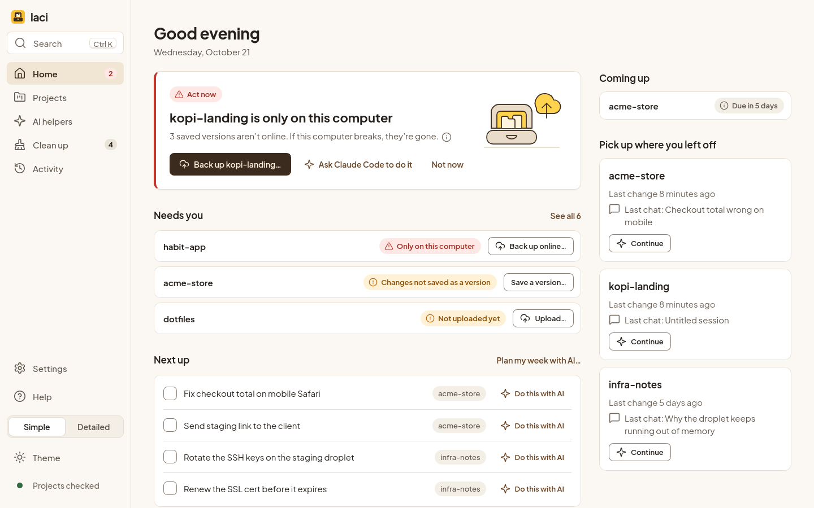
</picture>

> Status: 3.0.0 is the [latest release](https://github.com/mrramdn/laci/releases/latest), for Linux on x86-64. Rust + Tauri 2, with a React interface. See the [changelog](CHANGELOG.md).

## Contents

- [Two designs: Simple and Detailed](#two-designs-simple-and-detailed)
- [Install on Linux](#install-on-linux)
- [Updates and privacy](#updates-and-privacy)
- [Why](#why)
- [What it does](#what-it-does)
- [Using it](#using-it)
- [How it works](#how-it-works)
- [The `.laci.md` file](#the-lacimd-file)
- [Session reports](#session-reports)
- [Safety](#safety)
- [Configuration](#configuration)
- [Development](#development)
- [Roadmap](#roadmap)
- [FAQ](#faq)
- [License](#license)

## Two designs: Simple and Detailed

Laci has two designs. Both show the same projects, AI chats, to-dos and Log, and both can undo the same changes. Only how they look and how much they show at once differ.

**Simple** is new in 3.0, made for people who are new to Git and coding agents, and it is what a new install opens in. It says things in plain words ("saved version" for a commit, "upload" for a push) and names the Git word in Help. It shows one suggestion at a time, offers Archive before Delete, and waits 5 seconds, with Cancel, before anything that can't be undone. The picture at the top is Simple's Home, light or dark as your system is.

<picture>
  <source media="(prefers-color-scheme: dark)" srcset="docs/screenshots/today-dark.png">
  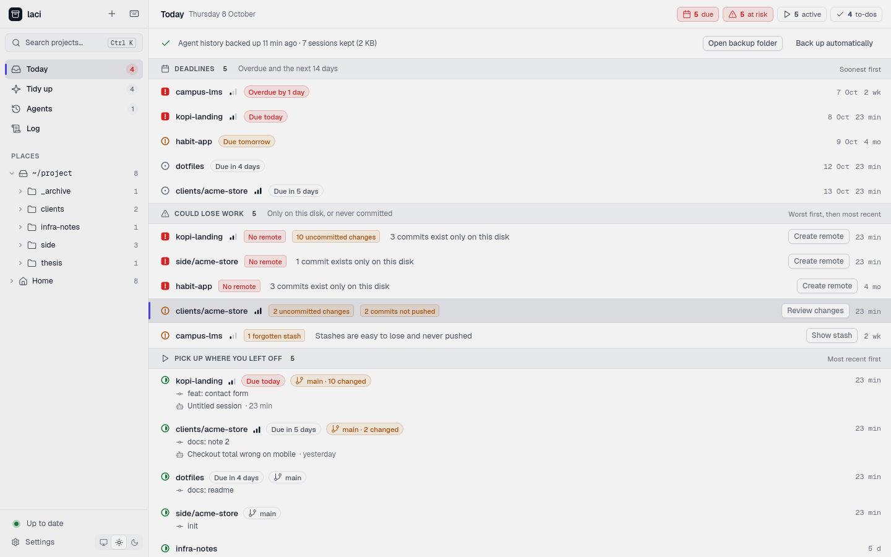
</picture>

**Detailed** is the classic view: paths, Git details and long lists, all at once. If you used Laci 2, it stays your design after the update, and a card on Today offers Simple once. The picture above is Detailed's Today.

Switch any time, and the change shows at once:

- **Settings › Appearance**: pick Simple or Detailed.
- **The toggle at the foot of the sidebar**: *Simple | Detailed*, in both designs.
- **<kbd>Ctrl</kbd> <kbd>K</kbd>**: *Switch to Simple view* or *Switch to Detailed view*.

The choice is saved as `design` in [`config.json`](#configuration). The two designs name their places differently:

| Simple | Detailed |
| --- | --- |
| Home | Today |
| Projects | The folders under *Places*, and Browse |
| AI helpers: Chats, Summaries, Tools | Agents, and Reports |
| Clean up | Tidy up |
| Activity | Log |
| Settings, Help | Settings, Help |

[What it does](#what-it-does) uses Detailed's names; everything there works in Simple too.

## Install on Linux

Laci runs on Linux. Windows and macOS versions won't be made: porting is complex, and more than its maintainer can take on for now.

### Requirements

- Linux on x86-64, with WebKitGTK 4.1 and glibc 2.35 or newer: Ubuntu 22.04, Linux Mint 21, Zorin OS 17, Pop!_OS 22.04, Debian 12, a current Fedora, or anything newer.
- `git`.
- `gio` (from GLib), for moving things to the Trash.
- `xdg-open` (from xdg-utils), for opening files and links.
- The AppImage may need FUSE 2: the package `libfuse2t64` on Ubuntu 24.04 (`libfuse2` on older ones), `fuse-libs` on Fedora or `fuse2` on Arch. Without it, start the AppImage with `--appimage-extract-and-run`.
- Optional: `gh` or `glab`, to create an online copy of a new project from *New project*.

The deb and rpm install what they need themselves.

### Download

Every release is on the [releases page](https://github.com/mrramdn/laci/releases/latest). Pick one file:

| File | For | Updates |
| --- | --- | --- |
| `laci_<version>_amd64.AppImage` | Any of the Linux systems above; nothing to install | Laci updates it itself, after asking you |
| `laci_<version>_amd64.deb` | Ubuntu, Debian, Linux Mint, Pop!_OS | Download the new deb from the releases page |
| `laci-<version>-1.x86_64.rpm` | Fedora and others that use dnf | Download the new rpm from the releases page |

To check that a download is the one GitHub built, follow [Verify a download](RELEASING.md#verify-a-download).

### The AppImage

1. Download the AppImage and put it where it can stay, for example in `~/Applications`.
2. Make it executable: in your file manager, open its *Properties* and allow running it as a program, or in a terminal:

   ```sh
   chmod +x ~/Applications/laci_*_amd64.AppImage
   ```

3. Double-click it, or run `~/Applications/laci_*_amd64.AppImage`.

When a new version is out, Laci can download and install it for you, after you click (see [Updates and privacy](#updates-and-privacy)). Keep the AppImage where it is once your agents use Laci through [MCP](#agents-mcp): they start that file.

### The deb or the rpm

In a terminal, in the folder you downloaded it to:

```sh
sudo apt install ./laci_*_amd64.deb      # Ubuntu, Debian and the like
sudo dnf install ./laci-*.x86_64.rpm     # Fedora
```

Laci then appears with your other apps, and the `laci` command is installed for the [CLI](#cli) and [MCP](#agents-mcp). For a new version, download the new file and install it the same way: apt and dnf replace the old one. Laci tells you when one is out, with a link to its page, if you let it look.

A release candidate (a version like `3.0.0-rc.2`) is the exception: apt and dnf take it for newer than the final `3.0.0`. If you installed one, remove it first with `sudo apt remove laci` or `sudo dnf remove laci`, then install the final version. Your settings and data stay.

To remove Laci, run `sudo apt remove laci` or `sudo dnf remove laci`, or delete the AppImage. Your settings and Laci's own data stay in `~/.config/laci` and `~/.local/share/laci` (see [Configuration](#configuration)).

### From Laci 2

Laci 2 can't update itself, so download 3.0 by hand once. From then on the AppImage updates itself.

- **AppImage:** put the 3.0 AppImage where the old one was, make it executable, and delete the old file. AI agents you let use Laci under Laci 2 still start the old file, so set them up again: in Detailed, press *Fix…* beside *Points elsewhere* on the Agents page; in Simple, open AI helpers › Tools and choose *Use this Laci…*.
- **deb or rpm:** install the new package as above. It replaces Laci 2, and agents keep starting the `laci` command.

Your settings, the Log and everything else Laci keeps stay as they are.

### The first launch

A fresh install starts with no folders or connectors, and does not look for repositories under Home by itself. The first launch asks:

1. Which folders hold your projects. *Suggest folders* finds some on request, and mounted drives work too.
2. Which AI tools you use: Claude Code, Codex, Antigravity, or none.
3. Which editor, file manager and terminal to open things with.
4. Whether Laci may look for new versions once a day (see below).
5. How Laci should look: Simple or Detailed.

You can change all of these in Settings. If you used Laci 1 or 2, your config is read as it is; nothing to import. Journals, backups, the Log and `.laci.md` keep their formats.

The app opens with its last scan while it checks for changes. Fonts are bundled. The desktop app, the CLI and the MCP server share one Rust engine; nothing needs Node or Electron.

### Build from source

Install Rust (the pinned version is in `rust-toolchain.toml`), Node 24+ and pnpm, and the platform dependencies in [Tauri's prerequisites](https://v2.tauri.app/start/prerequisites/). On Debian/Ubuntu:

```sh
sudo apt install libwebkit2gtk-4.1-dev build-essential curl wget file \
  libxdo-dev libssl-dev librsvg2-dev patchelf git libglib2.0-bin xdg-utils
pnpm install
pnpm build
```

The packages appear in `target/release/bundle/`. Run `target/release/laci`, or install that binary and its launcher with `sh scripts/install-desktop.sh`. A copy you built or installed that way doesn't update itself; Laci links to the release page instead.

## Updates and privacy

Laci asks before it looks for new versions, and never installs one without a click.

**What a check does.** Once a day, if you said yes, Laci asks GitHub for one small file, `latest.json`, from the newest release of this repository. That is one HTTPS request (GitHub may redirect it to its download server). Like any visit to a website, it shows GitHub your IP address, and the request carries the user agent of the updater library Laci uses (`tauri-plugin-updater` and its version). It sends nothing about your projects, needs no account, and Laci has no telemetry. If you said no, Laci makes no request at all unless you press *Check now* in Settings.

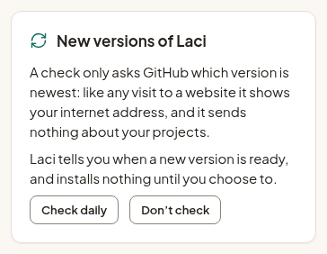

**Who is asked.** A new install asks on its first-run screen. If you used Laci 2, or skipped that screen, a card on Home (Simple) or Today (Detailed) asks once, with *Check daily* and *Don't check*, and stays until you answer.

**What happens when there is a new version.**

- **AppImage:** Laci tells you (Home's card in Simple; a badge at the foot of the sidebar in Detailed) and shows what's new. *Install* downloads it, checks that it carries Laci's signature, and replaces your AppImage; *Restart* finishes it, and closes Laci's terminals and the AI chats running in them. Nothing is downloaded before you click, and a download without the signature is refused.
- **deb, rpm, or a copy you built:** Laci only tells you, with a link to the release page. Your package manager installs the new version.

**Turn it off or on** in Settings: *Updates* in Simple, *About & updates* in Detailed. Or set the `updates` key in `~/.config/laci/config.json`, beside the keys already there:

```json
{
  "roots": ["~/project"],
  "updates": "off"
}
```

`"off"` stops the daily check and `"daily"` turns it on. Without the key, Laci doesn't look, and asks you once.

## Why

If you work with coding agents, your projects folder gets messy in ways a regular file manager can't show:

- **Work only exists on your disk.** Repos with no remote, uncommitted changes, forgotten stashes. Nothing tells you until the disk dies.
- **Agent history is tied to a path.** Claude Code keeps sessions and memory under `~/.claude/projects/<encoded path>`. Codex writes the path into every log. Move or rename a folder and that history is detached. Ask an agent to "sort my projects" and it will `mv` things and leave the history behind.
- **Next steps are scattered.** They sit in `HANDOFF.md`, `TODO.md`, `NOTES.md` and chat history, and nobody reads them again.
- **Old history disappears.** Claude Code deletes session logs after 30 days by default.

laci puts all of this in one place and makes moving projects safe.

## What it does

The sections below use Detailed's names. Simple has the same features under its own names (see [the table](#two-designs-simple-and-detailed)) and in plainer words.

### Today: what needs you

The home screen answers "what should I look at?". Each list says how it's ordered.

- **Deadlines**: overdue projects and the next 14 days, soonest first, with their priority. Shown only when there are any.
- **Could lose work**: no remote, never committed, uncommitted or unpushed changes, a branch that has diverged from its remote, stashes. One row per project, every issue as a chip, and a one-click fix for the worst one (for example *Create remote* or *Push*) that opens in the built-in terminal. A diverged branch gets no Push or Pull: neither would fix it.
- **Pick up where you left off**: recently active projects, each with its last commit and last agent session.
- **Open to-dos**: every open `- [ ]` checkbox across your notes files, plus next steps you add in laci. **Work on it** (the play button) starts an agent in the project's folder with that to-do as its first prompt.
- **Handoffs**: `HANDOFF.md` or `TODO.md` files that still have open items under a TODO heading.

Each list opens the tab that fits it: a risk opens Health, a recent project opens Agents, a deadline opens To-do.

Simple's Home puts the one project that needs you most on top, with its fix and *Ask Claude Code to do it* (or your AI) beside it, then the others that need you, what's next and where you left off.

### Review with an agent

When the notes pile up faster than the work gets done, **Review with an agent…** at the top of Today starts Claude Code, Codex or Antigravity with a brief, in the built-in terminal or your own. The agent works through Laci's [MCP server](#agents-mcp):

1. It reads every open to-do, report item, risk and cleanup.
2. It checks against the git log, pull requests and files what is already done.
3. It proposes what to tick, delete, split, move or close, three to five things for the week, and the questions only you can answer.
4. After you agree, it makes the changes with Laci's tools, so each one is in the Log with Undo.

Work that belongs to one project stays a to-do there, for **Work on it**. You see the prompt in the start dialog and can change it before the agent starts. The agent needs Laci's MCP server; its card on the Agents page sets that up.

### Browse everything

Every folder and file, like Dolphin or GNOME Files, with projects marked by their status, summary, stack, agent sessions and health. *Modified* means the same on every row: when anything inside last changed, whether a file, a commit or an agent session.

- **Filters**: *All files* shows the folder you're in. *Projects*, *Uses laci*, *Agent sessions* and *Needs attention* list matching projects in this folder and every folder below it.
- **Display**: sort by name, modified, size or agent sessions in either direction, keep folders first or mix them in, and show hidden files or archived projects. Column headers sort too.

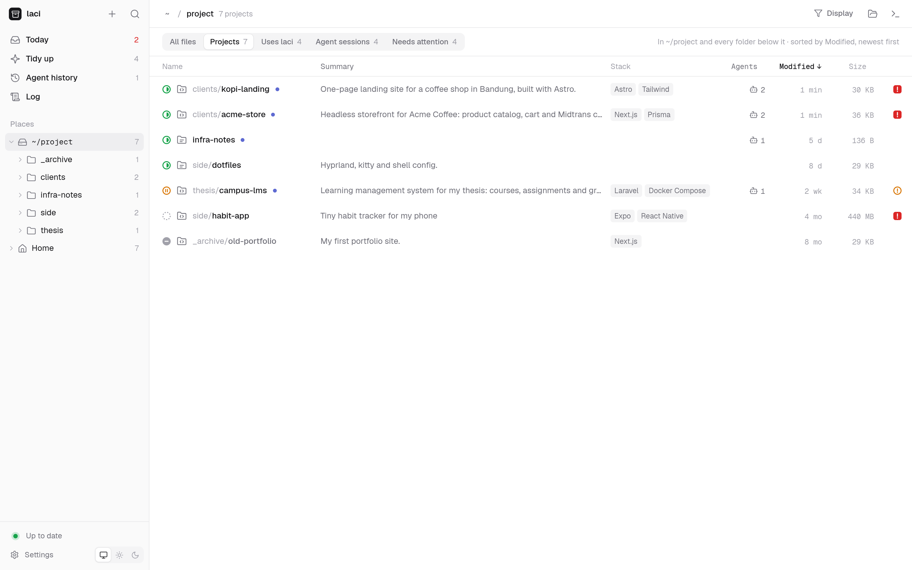

### Projects and details

Select a project to see its summary, status, priority, deadline, remotes, branch, stack and size. When build output (such as `target` or `node_modules`) takes much of the size, **Delete build output…** frees it for good; the next install or build brings it back. It is not moved to the Trash, which would keep the space taken. The panel has four tabs:

- **Health**: checks with what stands behind them (the changed files, the commits not pushed, the stashes), a release line (declared version, last tag, commits since), recent commits and a commit chart. Any check except a deadline can be muted for that project: it stays listed under *Muted* and is counted nowhere else. Muted checks are kept in the project's `.laci.md`.
- **To-do**: next steps and notes. **Work on it** on an open to-do starts an agent on it.
- **Agents**: sessions, memory and plans from every connected tool.
- **README**: the rendered README.

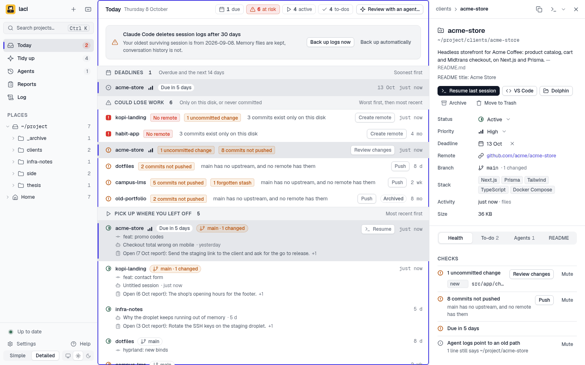

**Secrets stay off the internet.** Before a first commit, a new remote or a push, Laci looks for files that look like passwords or keys, such as `.env`, by their names only. If it finds any, it lists them: **Keep these out** adds them to `.gitignore`, with Undo, and *Continue* goes on without.

In Simple, a project's page starts with *Is it safe?*: each problem in plain words, the button that fixes it, and *Ask Claude Code to do it*, which asks your AI to show each command first and never to force a push, rewrite history or delete a branch.

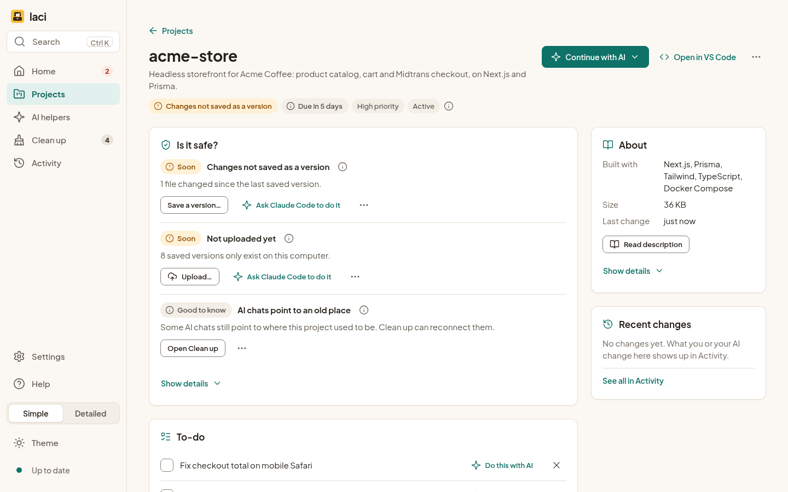

### Tidy up

laci finds cleanups and shows exactly which files each one touches before anything changes. They're grouped by kind, fixes for broken links first:

- **Reconnect** agent history left at a folder's old address.
- **Finish half-done moves**: session folders that were renamed while the logs inside still record the old path.
- **Free space** from `node_modules` and build output in dormant or archived projects.
- **Duplicates**: the same repo cloned in two places.
- **Quarantine** sessions whose recorded owning folders are all confirmed missing, or explicitly move the selected history to **system Trash**. Shared history with a live owner, incomplete or unreadable logs, offline drives and ambiguous locations block cleanup. Laci rechecks sources, reconnection and running writers when you apply it.
- **Archive** projects nobody has touched in a while, as long as nothing in them is uncommitted, unpushed or stashed.

Any suggestion can be dismissed; it stays away for 90 days, and the dismissed ones are listed at the end so you can ask for one again.

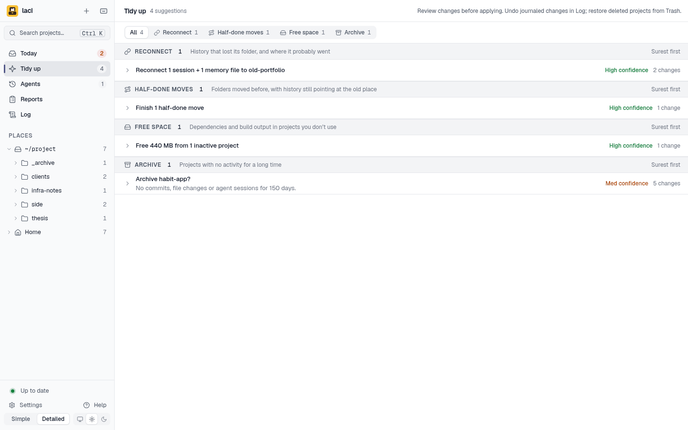

Apply finishes when the filesystem change is saved; the view refreshes in the background. While history is being refreshed, further history-changing actions wait and old Tidy suggestions are cleared. Navigation and project metadata edits remain available. If the refresh fails, laci reports that the change was saved and asks you to scan again; it retains the Undo action.

### Archive and move, with the history attached

Choose a default archive folder in Settings, including a folder on a mounted drive. Leave it empty to use the nearest `_archive/` folder. The Archive dialog lets you choose a different final project path and previews that exact destination. Custom destinations outside the scan roots stay discoverable; their scan-root addition is included in the move journal. laci also moves its agent history (Claude's session folder, and whatever else your connectors keep), rewrites the folder paths in the logs, and marks the project archived. Everything goes into an undo journal first.

If a selected destination folder or drive has been replaced, archiving stops. Choose a valid alternative, or clear the location in Settings, save, then select it again to accept its new identity.

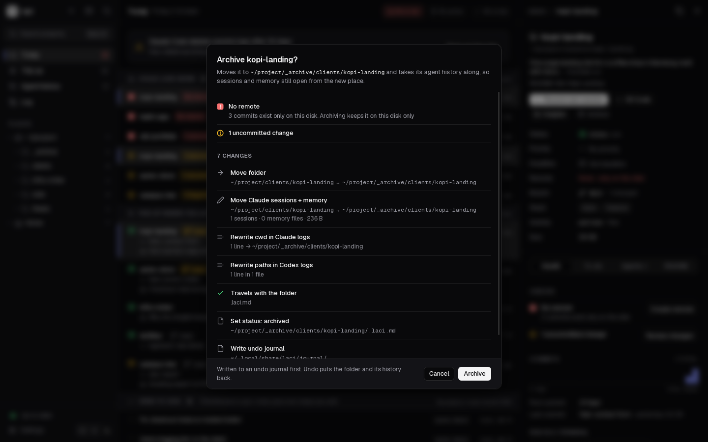

**Move to Trash** is available on individual projects and beside dormant-project Archive suggestions in Tidy. It requires a clean Git project with no untracked files, stashes, submodules or linked worktrees, and no process with its working directory inside the folder. Index entries marked `assume-unchanged` or `skip-worktree` block removal because they can conceal tracked changes. Laci contacts the preferred remote (`origin` first) and requires HEAD and local branches, tags and other non-remote refs to match a currently advertised branch or tag tip. It repeats local checks after the remote answers and before moving the folder. Unreachable remotes and unverified refs block removal; an older branch tip can be blocked even if its commits are on the remote. Local backup paths must be outside the project and have their own object storage; file URLs are refused.

The whole folder, including ignored files, moves to system Trash. Ignored files are not backed up by Git. Restore the project through your file manager; there is no Log Undo for this action. Agent history stored outside the project stays intact and can appear detached until the folder is restored. If the filesystem does not support system Trash, removal fails and the folder remains in place; choose Archive instead.

Simple has its own sheets for these: *Archive* is offered first, *Delete* lists the ignored files that only this computer has and asks you to type the project's name before they go, and *Free up space* says what it deletes for good. Whatever can't be undone waits 5 seconds, with Cancel, before it runs.

### Log

Every change laci makes, from the app or from an agent through MCP: moves, archives, Tidy fixes, deleted sessions, status, priority and deadline, to-dos, notes, connectors, settings and new projects. Moves expand to show what went where. Search it, or show only what can still be undone. Most changes have an *Undo*; simple edits that were changed again later say so instead of overwriting the newer change.

Undoing a deleted to-do requires its `.laci.md` to remain unchanged after deletion. If you edited it afterward, undo the newer edit first or restore the to-do manually.

Simple calls it Activity and says each change in plain words, such as "Reconnected the AI chats of shop" or "Set the priority of shop to high", with *What changed* for the details, *By me* and *By AI* filters, and Undo on each row.

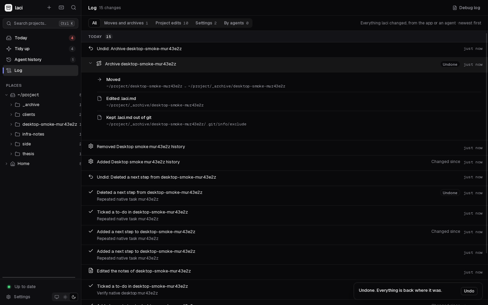

### Agents

The Agents page has one card per AI tool: whether it is connected and installed, how many sessions it has, the model and effort it starts with, and **Start…** to open it in a project.

Below the cards are your sessions, counted and listed as conversations: the logs of subagents and the stubs `/resume` leaves behind fold into the conversation they belong to. They are grouped by project, newest first; chats outside projects sit in one closed group. Chats of a couple of prompts that changed no file fold into one row. Each row says what happened in it: prompts, files changed, time spent, size and pull requests. Opening one shows its first and last prompt and the agent's last reply.

Select sessions to **Keep** them or **Delete** them. A deleted session goes, with its subagent logs and Laci's backup copy, to Laci's quarantine; Undo in the Log puts it back. Kept sessions are never offered for cleanup. Filters show short chats, sessions older than 30 days, those outside projects, kept ones and those only the backup holds, and search covers titles, prompts and projects.

**Storage and cleanup** has the history size per project, detached history, and what Laci keeps itself: the quarantine, undo copies of moves, the session backup (compressed, wherever it is kept) and files left by Laci 1. The quarantine, undo copies older than a week and the Laci 1 files can be freed from there; nothing is ever removed from the backup.

A connector tells laci where an AI tool keeps its history, so it shows on the right project and travels with it. Claude Code, Codex and Antigravity are offered as built-ins, enabled only when you select them. Previously configured integrations and custom stores remain readable; adding a built-in does not duplicate an existing store. Any other tool can be added with a short form, no code: its logs record the folder, it keeps one folder per project, it keeps history inside the project, or its files mention project paths.

Codex titles use its title index, then a bounded first user message, then a short session ID. Claude Code sessions without a title take their first prompt. Subagent logs appear inside their conversation. Home sessions stay global and can be inspected and resumed without a matched project. Antigravity uses `agy` and its last-conversation index; it does not expose full titles or resumability for history-only records. Laci does not edit provider title/model settings.

Claude Code, Codex and Antigravity are built in. Any other tool can be added with its command name in **Add another AI tool**; how it takes a first prompt, continues its last conversation and picks a model is optional. A tool does not need a history store that Laci can read. The same description can be written in `~/.config/laci/config.json`:

```json
{
  "custom": [
    {
      "id": "custom-aider",
      "name": "Aider",
      "link": { "kind": "inside", "path": ".aider.chat.history.md" },
      "agent": {
        "command": "aider",
        "prompt": ["--message", "{prompt}"],
        "model": ["--model", "{model}"],
        "models": [{ "id": "sonnet" }]
      }
    }
  ]
}
```

`{prompt}` and `{model}` stand for the value. Each list element is passed as one argument, never through a shell. `link` can be left out for a tool whose history Laci cannot read.

Claude Code deletes session logs after a retention period. **Back up logs now** copies agent logs, each compressed with zstd (chat logs get about five times smaller), to `~/.local/share/laci/history` or to the folder you choose in Settings; Today then shows when the backup last ran and how many sessions it keeps, with **Open backup folder**. Automatic backup is optional and runs at most once an hour, only when a session changed. Nothing is ever removed from the backup. Sessions a tool has deleted stay listed from the backup, marked "In backup only", and can be restored. A backup from before 3.1 is compressed on the next run: each file Laci packs is checked byte for byte before the plain one goes, and a plain file that already has a newer packed copy beside it just goes. Temporary files a stopped copy left behind are removed.

The backup can live in any empty folder, also on another drive: **Settings › Backup folder › Change…** in Detailed, *Where Laci keeps the copy* under **AI helpers** in Simple. Laci moves what the backup holds there in one change, which Undo in the Log moves back, also what the backup gained since; settings you changed meanwhile stay as they are. **Use the default** brings it back to Laci's data folder. Laci never makes a chosen folder: when its drive isn't connected, the backup stops with a message and copies nothing, and the folder's drive is recognised as Laci recognises scan locations. While it can't reach the backup, Laci doesn't move it; you can start a new backup in another folder instead, and the old one stays on its drive. A move or its Undo that stops part-way, as when Laci is closed, is finished by the next backup or move, into the folder the setting names. The folder can't be your home folder or one above it, one of Laci's own folders, or one that holds an agent's history or lies inside it. A folder that holds a backup Laci made before (it has a `.laci-copy` file) can be chosen while the current backup is empty. Each file is a plain zstd file: `zstd -d` unpacks it without Laci.

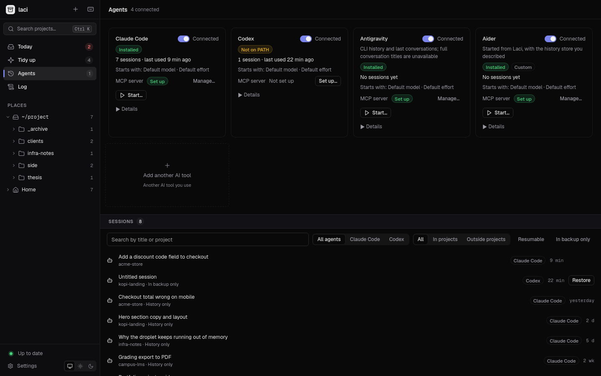

### Reports

Agents can write a short Markdown report when a session ends: what was asked, what changed, what works now and what is still open. Choose the folder they write to in Settings, and **Reports** appears in the sidebar. The reports are listed newest first on the left, and the one you pick reads on the right. Search covers titles, summaries and projects at once, and the full text a moment later. A long report gets a row of its sections to jump between.

A report links to the projects and agent sessions its header names, by path or by session id. Through the session id it still finds a project that Laci moved. Each place shows the link:

- A report icon on the session's row, and **Report** in the session dialog.
- A Reports section in the project's Agents tab.
- On Today, a line under the project with the first thing its latest report left open.

A report's *Open items* can be closed as done or dropped, in Reports or from that line on Today, and opened again. Laci keeps this in its own data, so a closed item leaves Today and the counts while the report stays as written. The Log can undo each one.

The sidebar counts reports added since you last looked. Laci never changes the folder. The format, and the instruction to give your agent, are in [Session reports](#session-reports).

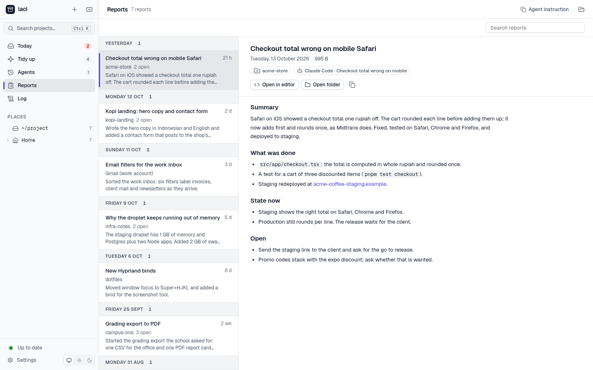

### New project

<kbd>+</kbd> in the sidebar creates an empty project, copies a local template, clones a URL, or runs a generator recipe. Templates can live in `~/.config/laci/templates` or a folder you reference in the form. Vite is the initial generator preset; you can save custom recipes as a program and argument list.

Preview a generator before starting. The preview shows its command, runtime and download requirement. Generation runs in the background with bounded output, a cancellation control and a 15-minute timeout. A failure keeps the partial folder for inspection. Laci writes project metadata and initializes Git after successful scaffolding. Remote creation remains optional. The form also lets you include only the new folder in scan locations.

Agent launch is an optional continuation for any source. Choose a connected provider, prompt, terminal target and supported model/effort overrides. Default omits override flags and uses provider settings. Load models on demand; unavailable discovery keeps Default usable. If launching fails, retry it without creating or pushing the project again.

Reloading the window restores creation progress and Cancel. A pending agent launch resumes once after creation finishes. This recovery lasts while Laci is running; closing the app does not save the request or prompt to disk.

### Built-in terminal

Press <kbd>F4</kbd> for a terminal panel with real shells, one tab per project, each opened in the project's folder. *Resume session* uses the selected provider and session ID with an explicit project directory. Script buttons run `pnpm dev` and the like. Fix buttons show a command and wait for Enter. The inspector's Terminal control opens a shell in the selected folder (or a file's containing folder); its compact target menu overrides the Settings default for that launch. Tabs survive a window reload.

Hiding the panel keeps its sessions running. Closing a live tab asks for confirmation because it ends the shell and any running commands, and discards its output. Tabs whose shells have exited close directly.

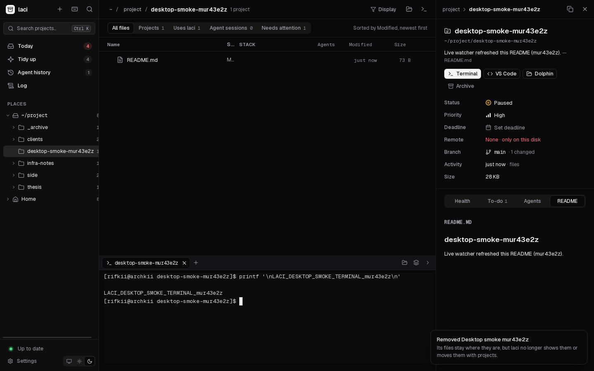

### Stays current

laci watches your project folders, each project's files and git state, the agent logs, the reports folder and the folders you have open. New folders, edits, commits and agent sessions show up on their own, usually within a couple of seconds. The sidebar says *Up to date*; click it to scan everything again if something looks off.

### For agents: MCP

laci ships an [MCP](https://modelcontextprotocol.io) server, so Claude Code, Codex, Antigravity and other agents can ask laci what exists, and move, archive or create projects the safe way instead of using `ls` and `mv`. What they change shows up in the Log. See [Agents](#agents-mcp).

### In the terminal

`laci doctor` prints what could be lost, open checkboxes and tidy-up suggestions without opening the app, and says when the reports folder can't be read.

## Using it

### Desktop app

| Key | Action |
| --- | --- |
| <kbd>Ctrl</kbd> <kbd>K</kbd> | Jump to any project, folder or action |
| <kbd>?</kbd> or <kbd>Ctrl</kbd> <kbd>/</kbd> | Help in Simple, Keyboard shortcuts in Detailed |
| <kbd>F4</kbd> or <kbd>Ctrl</kbd> <kbd>`</kbd> | Show or hide the terminal |
| <kbd>F6</kbd> / <kbd>Shift</kbd> <kbd>F6</kbd> | Move between the parts of the window: the sidebar, the page, the details panel and the terminal |
| <kbd>Esc</kbd> | Close a menu, a sheet or a dialog, or Detailed's details panel |

In Detailed's lists and folders:

| Key | Action |
| --- | --- |
| <kbd>Ctrl</kbd> <kbd>H</kbd> | Show or hide hidden files |
| <kbd>↑</kbd> <kbd>↓</kbd> <kbd>Enter</kbd> | Move through lists and open |
| <kbd>←</kbd> <kbd>→</kbd> | Collapse or expand a folder in the sidebar tree |
| <kbd>Backspace</kbd> | Go up one folder |

Every button also works with Tab and Enter.

Escape closes one active layer at a time. A dropdown closes first; a form asks whether to keep editing or discard its draft. While a dialog is open, Tab stays inside it, and the palette and terminal shortcuts are inactive. F4 also works while typing in the terminal; it stays blocked while the command palette is open.

In the details panel, click **Status**, **Priority** or **Deadline** to change them. They are saved to the project's [`.laci.md`](#the-lacimd-file). **Editor** and the file manager button open the apps you picked in Settings. The theme (like the system, light or dark) is at the foot of the sidebar in both designs.

The window can be as small as 720 × 560. The interface runs inside Tauri’s native WebKit webview. Use `pnpm dev` when developing it.

### CLI

```sh
laci ls        # every project, newest activity first
laci doctor    # work at risk, open checkboxes and tidy-up suggestions
laci json      # the complete scan as JSON
laci backup    # copy new and changed AI chats into the backup, as "Back up logs now" does
```

#### Back up AI chats while Laci is closed

The window copies AI chats only while it is open, but a tool that deletes old chats (Claude Code, after 30 days by default) deletes them whether or not Laci was open. `laci backup` makes the same backup as **Back up logs now** without the window and without scanning your projects, whether or not automatic backup is on in Settings. It prints one line, such as `Copied 3 files · 912 sessions kept · 1.0 GB in /mnt/archive/ai-chats`, adds it to the Log when it copied something, and exits with 1 and the reason when the backup folder can't be used, as when its drive isn't connected. It waits for nothing: while the window is changing files, it says so and stops.

To run it every hour with systemd, save these two files in `~/.config/systemd/user/`. Use the path of your Laci in `ExecStart`: `/usr/bin/laci` for the .deb and .rpm packages, `%h/.local/bin/laci` for a build installed with `scripts/install-desktop.sh`, or the full path of the AppImage, such as `%h/Applications/laci_3.1.0_amd64.AppImage` (it keeps its name when Laci updates it). The AppImage needs FUSE 2 here too.

```ini
# laci-backup.service
[Unit]
Description=Copy new AI chats into Laci's backup

[Service]
Type=oneshot
ExecStart=/usr/bin/laci backup
Nice=10
IOSchedulingClass=idle
```

```ini
# laci-backup.timer
[Unit]
Description=Copy new AI chats into Laci's backup every hour

[Timer]
OnCalendar=hourly
Persistent=true
RandomizedDelaySec=5min

[Install]
WantedBy=timers.target
```

Then turn it on with `systemctl --user daemon-reload && systemctl --user enable --now laci-backup.timer`. `journalctl --user -u laci-backup` shows what each run said.

### Agents (MCP)

Laci can set this up for you. In Detailed, each card on the Agents page says whether Laci's MCP server is set up for that agent: "Set up", "Not set up", "Points elsewhere" or "Switched off", with **Set up…** or **Fix…**. In Simple, the same is under **AI helpers › Tools**, as *Let it use Laci*. Either way Laci shows the exact command or JSON first, then runs the agent's own command (or edits its JSON settings, after keeping a copy in `~/.local/share/laci/mcp-backups/`). The steps below do the same by hand.

The server is `laci mcp`, over stdio; it starts no window. Use the full path of your Laci:

- the deb or rpm: `/usr/bin/laci`;
- the AppImage: the AppImage file itself, such as `/home/you/Applications/laci_3.0.0_amd64.AppImage` (set it up again if you move or rename the file);
- a build installed with `scripts/install-desktop.sh`: `/home/you/.local/bin/laci`.

```sh
claude mcp add laci --scope user -- /usr/bin/laci mcp     # Claude Code
codex mcp add laci -- /usr/bin/laci mcp                   # Codex
agy mcp add laci /usr/bin/laci mcp                        # Antigravity
```

Codex keeps it in `~/.codex/config.toml`, which you can also edit yourself:

```toml
[mcp_servers.laci]
command = "/usr/bin/laci"
args = ["mcp"]
```

Any other agent that speaks MCP over stdio can start the same command with the argument `mcp`. To have Laci set it up from its Agents page, describe the agent with **Add another AI tool** and name its MCP settings file (JSON); in `config.json` its `mcp` entry can also give the agent's own add and remove commands.

Then ask your agent things like *"which projects could lose work?"*, *"archive dummy2"*, *"move ~/Downloads/foo into ~/project/clients"* or *"start a new project called shop-api in ~/project/clients"*.

| Tool | What it does |
| --- | --- |
| `list_projects` | Projects with status, activity, summary and problems, the most recently active first. Filter by status, `at_risk` or words |
| `project_details` | Git, stack, to-dos, notes, the start of the README, the newest agent sessions, memory, the newest session reports and archive destination of one project |
| `list_reports` | Session reports, newest first, with summary, open items and the file to read. Narrow by project or by words |
| `needs_attention` | Work at risk, deadlines and how many to-dos are open, the worst first |
| `open_items` | Open to-dos and report items, the most pressing projects first. Narrow by project, kind or words |
| `tidy_suggestions` | The Tidy up list |
| `set_project_fields` | Status, priority, deadline |
| `add_next_step`, `complete_task`, `edit_task`, `delete_task`, `move_task`, `write_notes` | Add, tick, rewrite, delete or move to-dos, and edit notes |
| `close_report_item` | Close a report's open item as done, dropped or moved, or open it again. The report file stays as written |
| `move_project`, `archive_project`, `delete_project`, `apply_suggestion`, `create_project`, `undo_change` | Changes on disk. Two calls: the first returns the plan, the second (with `confirm: true`) runs it |
| `recent_changes` | The Log, newest first, and which entries can be undone. Narrow by project, words or `undoable` |

Projects in lists and in answers to changes are short: status, priority, deadline, checks and to-dos. `project_details` has the stack, the start of the README, the newest sessions and the archive plan.

Lists answer a page at a time: `list_projects`, `needs_attention`, `recent_changes` and `tidy_suggestions` 30 entries, `open_items` 50 and `list_reports` 10. `limit` sets the size of a page; when an answer says `more`, call again with `offset`.

The server also offers two prompts, which the desktop app uses for its buttons. In Claude Code, they are slash commands such as `/mcp__laci__review`.

| Prompt | What it starts |
| --- | --- |
| `review` | Going through everything open with you, as **Review with an agent…** on Today does |
| `work_on` | Work on one to-do (`project`, `task`), as **Work on it** does |

Moves and new projects must stay inside home or a scan/archive folder explicitly selected in Settings, and only one laci process (the app or an agent) changes files at a time.

## How it works

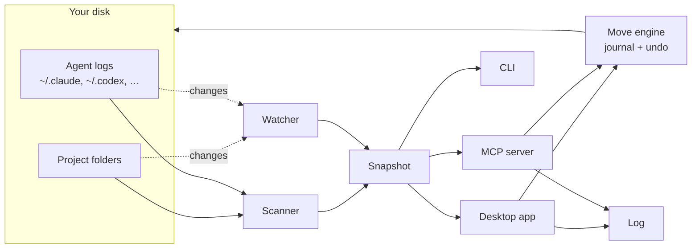

- **Finding projects.** laci walks the folders you picked (Settings). A folder is a *project* if it has `.git` or a build file (`package.json`, `go.mod`, `Cargo.toml`, `pyproject.toml`, `composer.json`, `pubspec.yaml` and more). A folder that only holds notes, or one an agent worked in, is a *docs project*. A folder of projects is a *group*. These are fixed rules, not guesses by an AI.
- **Reading each project.** It reads the git state (commits, remote, branch, uncommitted, unpushed, stashes and weekly activity), the README (title, summary, links), the stack from package files, and to-dos from `.laci.md`, `HANDOFF*.md`, `TODO*.md`, `NOTES*.md` and `tasks/todo.md`.
- **Linking agent history.** Each connector says how its tool links history to a folder. Claude Code names its session folders after the path with every non-alphanumeric character turned into `-`, so the name can't be decoded back; laci walks the real filesystem to find the folder a name belongs to. Codex logs are linked by the `cwd` inside them, Gemini CLI by a hash of the path, and Claude plans by the paths they mention. Parsed facts are cached; transcript reads are bounded, with the head used to establish cleanup ownership and a recent window used for current session metadata.
- **Reading reports.** With a reports folder set, laci reads the Markdown files directly in it: title, header lines, summary and open items. A report links to the deepest project that contains a path in its header, the folder its session started in, or the folder a session it names last worked in.
- **Staying current.** After a scan, laci watches the folders where projects live, the files and git state of each project, the agent log folders and the folders open in the app. It then re-reads only what changed: one project, the agent logs, or (when folders appear or disappear) a full scan.
- **Status.** Status is set automatically from the last activity (commit, file change or agent session): *active* within 14 days, *idle* within 60, *dormant* after that, and *archived* inside an archive folder or after an explicit archive action. Set it by hand to override. Editing `.laci.md` doesn't count as activity.
- **Former locations.** When a session folder resolves to a real folder but its sessions *started* somewhere that no longer exists, that old path is a former location. This is how laci spots half-done moves and renames, such as a repo renamed from `shop-old` to `shop`.

## The `.laci.md` file

The things you set yourself (status, priority, deadline, next steps and notes) live in a small file inside the project, so they move with it and any editor or agent can read them:

```markdown
---
status: active
priority: high
deadline: 2026-10-15
---

## Summary
One or two sentences about the project. Shown instead of the README tagline.

## Next
- [ ] Fix checkout total on mobile Safari

## Notes
Client wants the launch before the coffee expo.
```

laci adds `.laci.md` to the repo's `.git/info/exclude` (not `.gitignore`), so it is never committed and your repo files stay unchanged.

## Session reports

A report is one Markdown file per session, directly in the reports folder. laci reads its title (the first `# ` line) and three header lines. All of them are optional:

```markdown
# Checkout total wrong on mobile Safari

- **Date:** 2026-10-13
- **Session:** ~/project/clients/acme-store · 5f0c2a1e-8d4b-4c7a-9e21-3b6d0f9a7c42
- **Projects:** ~/project/clients/acme-store, Figma file "Checkout"

## Summary
Safari showed a total one rupiah off. Fixed and deployed to staging.

## Open
- Send the staging link to the client.
```

- **Date** dates the report. Without it, laci uses the date the file name starts with, then the file's time.
- **Session** names the folder the agent started in and its session id. The id links the report to that session in Claude Code, Codex or Antigravity; the folder links it to the project it is in.
- **Projects** names the projects worked in, by path; `~/project/{api, web}` names both. Anything that isn't a path, like the Figma file above, is shown as written.
- The first paragraph of **Summary** shows in the list, and the items under the last **Open** heading on Today.

The folder's `README.md` and files whose names start with a dot are not reports. Reports are read as UTF-8 text, up to 2 MB each.

To have an agent write them, add this rule where it reads its instructions: `~/.claude/CLAUDE.md` for Claude Code, `~/.codex/AGENTS.md` for Codex or `~/.gemini/GEMINI.md` for Antigravity. **Copy agent instruction** in Settings copies it with your folder filled in.

````markdown
## Session reports

When a session finishes real work, write a report about it in `~/notes/agent-reports`. Skip quick questions that change nothing.

- One file per session, named `YYYY-MM-DD-short-title.md` after the day the session started. If the session continues later, update that file instead of writing a new one.
- Use this layout:

```markdown
# Title saying what the session was about

- **Date:** YYYY-MM-DD
- **Session:** <folder you were started in> · <your session id, if you know it>
- **Projects:** <full path of each project you worked in>

## Summary
Two or three sentences: what was asked and where it ended up.

## What was done
What changed, grouped by project, and where it lives.

## State now
What works now, and how that was checked.

## Open
One line per thing still to do, most important first, or `Nothing open.`
```

- No secrets in reports: name the file that holds a secret, never its value.
````

## Safety

| When | What happens |
| --- | --- |
| Scanning and watching | Read-only. `git status` runs with `GIT_OPTIONAL_LOCKS=0`, so it never touches the index |
| Status, priority, deadline, to-dos, notes | Written to `.laci.md` in the project |
| Ticking a checkbox | Changes that line in the file it came from, for example `NOTES.md` |
| Archive, move, reconnect, finish a move | Moves folders, renames agent history folders, rewrites the folder path in agent logs (keeping each log's time) |
| Free space | Deletes `node_modules`, `.next` and similar folders for good; an install or build brings them back |
| Back up logs, `laci backup` | Packs new and changed agent logs with zstd into the backup folder (`~/.local/share/laci/history`, or the one you chose); packs plain copies from before 3.1 after checking them; removes temporary files a stopped run left in it. Never removes a chat |
| Backup folder › Change… | Moves the whole backup into the folder you chose, also across drives, in one change; Undo moves it back. The folder it leaves stays |
| Reports folder | Read-only: lists, reads and searches the reports, never writes there |
| New project | Makes the folder; creates a remote repo only if you pick one. A template's own Git repository stays behind |
| First commit, new remote, push | Looks for files that look like secrets first, by name only, and offers to keep them out |
| Update check | Only if you allowed it, or when you press *Check now*: asks GitHub for `latest.json`. Only the AppImage installs an update, after a click, and only one signed with Laci's key |

- **Undo.** Every move and rewrite is written to `~/.local/share/laci/journal/` *before* it happens. Rewritten files are kept in `~/.local/share/laci/backup/`. Undo restores them byte for byte. If a step fails midway, laci rolls back what it already did.
- **Archive and trash recovery.** Undoing an archive restores the saved `.laci.md` in full and can replace edits made while archived. Recover trashed orphan history from system Trash; journal Undo does not restore it. Deleted dependencies and build output come back with the next install or build. Pure Trash actions have no Laci Undo. Mixed actions explain which moves or edits Undo can restore.
- **Log.** Every change is also listed in `~/.local/share/laci/activity.jsonl`, which the Log page reads. Undo from the Log goes through the same checks as the app, and stays inside home, explicitly selected workspace folders and the backup folder you chose.
- **Busy folders are refused.** If a running process (a `claude` session, a dev server) has its working directory inside a folder, laci won't move it. If Laci can't tell, for example because `/proc` can't be read, it refuses too.
- **Names are names.** Names Laci reads from a project, such as Git tags, remotes and branches, are passed to the programs it runs as names, never as options, and so are the ones in the prompts it gives your AI.
- **One change at a time.** A lock file keeps the app and agents from changing files at once.
- **Your settings are kept.** If `config.json` is there but can't be read, Laci won't write over it, and says so.
- **Local only.** The React interface uses Tauri IPC, with no local HTTP server. Fonts are bundled. Rendered Markdown is sanitized, and only scanned project folders and the reports folder can serve local images. There is no telemetry. The only request Laci makes by itself is the update check, and only if you allowed it (see [Updates and privacy](#updates-and-privacy)).

## Configuration

Settings are saved in `~/.config/laci/config.json` (or under `$XDG_CONFIG_HOME`). Home paths use `~/…`; selected folders on other disks use absolute paths. Add the mounted folder path in Settings to scan that disk. Project operations stay inside home or explicitly selected scan/archive folders and reject symlink escapes.

| Key | |
| --- | --- |
| `roots` | Selected project folders, including mounted drives; `[]` leaves this selection empty (a configured archive is scanned separately) |
| `terminalTarget` | `internal` (default) or `external` for shell and agent launches |
| `templatePaths` | Local template folders referenced from New project |
| `recipes` | User-saved generator programs, argument arrays and prerequisite/download declarations |
| `archiveDir` | Default archive folder; empty or absent uses the nearest `_archive/` folder |
| `reportsDir` | Folder of session reports; empty or absent hides Reports. Read only, never scanned for projects |
| `presets` | Built-in connectors you added |
| `custom` | Connectors you described yourself |
| `apps` | `terminal`, `editor` and `files`: the programs laci opens things with |
| `theme` | `light` or `dark`; missing means follow the system |
| `design` | `simple` or `detailed`; missing means Detailed for a setup from Laci 2 and Simple for a new one |
| `updates` | `daily` to look for new versions once a day, `off` never to look by itself; missing means Laci asks once |

Environment variables win over the file, for one-off runs:

| Variable | Default | |
| --- | --- | --- |
| `LACI_HOME` | your home folder | Isolated project/config/data/cache home for demos and tests |
| `LACI_TERMINAL` | from Settings, else `kitty` | External terminal |
| `LACI_EDITOR` | from Settings, else `code` | Editor opened by **Editor** |
| `LACI_FILES` | from Settings, else `dolphin` | File manager |
| `LACI_UPDATE_ENDPOINT` | the newest release's `latest.json` | Another `https://` address for the update check, to try a release candidate |

Other files laci keeps:

| Path | |
| --- | --- |
| `~/.config/laci/templates/` | Starting points for *New project*: each folder is one template |
| `~/.local/share/laci/` | Undo journals, backups, the Log (`activity.jsonl`) and the debug log (`laci.log`) |
| `~/.local/share/laci/history/` | The agent history backup, each file compressed with zstd (`<file>.zst`), unless you chose another folder for it (`backupDir` in config.json) |
| `~/.cache/laci/` | What laci learned from agent logs and reports, the last scan, and when Laci last looked for a new version. Safe to delete |

## Development

```text
crates/laci-core/  scanner, readers, connectors, moves, journal, activity, config
src-tauri/        desktop IPC, watchers, PTY sessions, CLI and stdio MCP
ui/               React/TypeScript: the shared store and actions, Detailed (ui/src/views)
                  and Simple (ui/src/simple), styles and local assets
prototype/        preserved interface reference
scripts/          desktop install, isolated demo and validation
docs/             architecture, screenshots and the brand (the open-drawer mark)
```

```sh
pnpm dev                 # Tauri + Vite, with reload
pnpm typecheck
pnpm lint
pnpm test
pnpm build               # AppImage, deb and rpm
pnpm ui:preview          # the interface in a browser, with the desktop mocked: /preview.html
pnpm test:preview        # draws every screen of both designs in both themes
```

Use an isolated demo to try write actions:

```sh
node scripts/demo.ts /tmp/laci-demo
LACI_HOME=/tmp/laci-demo pnpm dev
```

`LACI_HOME` changes only the locations laci reads and writes. It leaves your shell's `HOME` and XDG variables alone. See [CONTRIBUTING.md](CONTRIBUTING.md) for native window checks and demo scan benchmarks, and [architecture](docs/ARCHITECTURE.md) for the engine and disk contracts.

## Roadmap

- Broader live agent orchestration
- File operations in the browser: copy, rename, individual-file delete, preview
- Search across agent sessions ("when did I talk about Midtrans?")

## FAQ

**Does it show every folder, like Dolphin?**
Yes. Browse from your project folders or from Home. Projects get their status and details on top of the usual file list.

**Will it change my repos?**
Only if you ask it to. Scanning is read-only, `.laci.md` is excluded from git, and moves go through the undo journal.

**Why does the first scan take a while?**
laci reads every agent log once to see which folder each belongs to. After that it only reads logs that changed, so later scans take a few seconds.

**Do I need to press "Scan again"?**
Normally no. laci watches for changes and updates by itself. A full scan is there in case something looks off.

**Does it send my code anywhere?**
No. Scanning stays local, and Laci has no telemetry. Laci itself only asks GitHub which version is newest, once a day, if you allowed it ([Updates and privacy](#updates-and-privacy)). If you launch an agent, clone a repository, create a remote or run a generator that downloads packages, that tool uses its own network connection and settings.

**Which design should I use?**
Simple if Git or coding agents are new to you, or if you want Laci to tell you what to do next. Detailed if you want every path, Git detail and list at once. Both do the same things, and you can switch at any time.

## License

Laci's code is licensed under the [MIT License](LICENSE). The name "Laci" and the logo are not covered by it.

The software, fonts and icons that Laci includes keep their own licenses. They are listed in [THIRD_PARTY_NOTICES.md](THIRD_PARTY_NOTICES.md).
