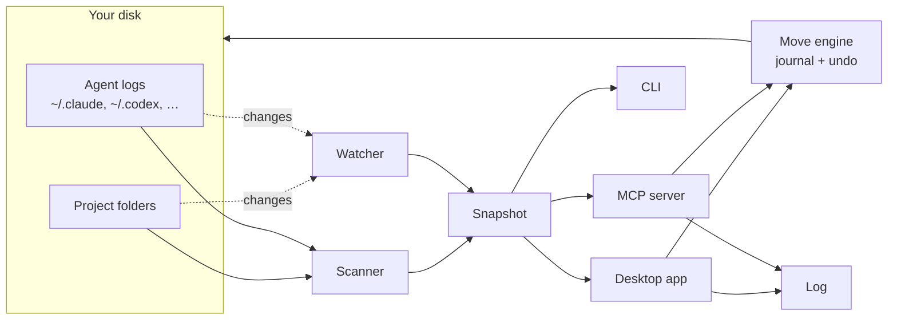

# laci

**A file manager for your projects folder that knows what's inside each project, including the AI agent history that belongs to it.**

*Laci* is Indonesian for "drawer".

laci shows every folder like a file manager, and for each project it adds its git state, README summary, stack, open to-dos, and the Claude Code, Codex or other agent sessions that worked in it. It warns you about work that exists only on this disk. When you move or archive a project, its agent history and memory move with it. laci logs its changes, offers Undo for most actions, and keeps itself up to date as you work.

<picture>
  <source media="(prefers-color-scheme: dark)" srcset="docs/screenshots/today-dark.png">
  
</picture>

> Status: 2.0.0-rc.1, Linux x86-64 release candidate. Rust + Tauri 2, with a React interface. Distribution builds target Ubuntu 24.04. See the [changelog](CHANGELOG.md).

## Contents

- [Why](#why)
- [What it does](#what-it-does)
- [Getting started](#getting-started)
- [Using it](#using-it)
- [How it works](#how-it-works)
- [The `.laci.md` file](#the-lacimd-file)
- [Safety](#safety)
- [Configuration](#configuration)
- [Development](#development)
- [Roadmap](#roadmap)
- [FAQ](#faq)
- [License](#license)

## Why

If you work with coding agents, your projects folder gets messy in ways a regular file manager can't show:

- **Work only exists on your disk.** Repos with no remote, uncommitted changes, forgotten stashes. Nothing tells you until the disk dies.
- **Agent history is tied to a path.** Claude Code keeps sessions and memory under `~/.claude/projects/<encoded path>`. Codex writes the path into every log. Move or rename a folder and that history is detached. Ask an agent to "sort my projects" and it will `mv` things and leave the history behind.
- **Next steps are scattered.** They sit in `HANDOFF.md`, `TODO.md`, `NOTES.md` and chat history, and nobody reads them again.
- **Old history disappears.** Claude Code deletes session logs after 30 days by default.

laci puts all of this in one place and makes moving projects safe.

## What it does

### Today: what needs you

The home screen answers "what should I look at?". Each list says how it's ordered.

- **Could lose work**: no remote, never committed, uncommitted or unpushed changes, stashes. Each row has a one-click fix (for example *Create remote* or *Push*) that opens in the built-in terminal.
- **Pick up where you left off**: recently active projects, each with its last commit and last agent session.
- **Open to-dos**: every open `- [ ]` checkbox across your notes files, plus next steps you add in laci.
- **Handoffs**: `HANDOFF.md` or `TODO.md` files that still have open items under a TODO heading.

### Browse everything

Every folder and file, like Dolphin or Finder, with projects marked by their status, summary, stack, agent sessions and health. *Modified* means the same on every row: when anything inside last changed, whether a file, a commit or an agent session.

- **Filters**: *All files* shows the folder you're in. *Projects*, *Uses laci*, *Agent sessions* and *Needs attention* list matching projects in this folder and every folder below it.
- **Display**: sort by name, modified, size or agent sessions in either direction, keep folders first or mix them in, and show hidden files or archived projects. Column headers sort too.


### Projects and details

Select a project to see its summary, status, priority, deadline, remote, branch, stack and size. The panel has four tabs:

- **Health**: checks and a commit chart.
- **To-do**: next steps and notes.
- **Agents**: sessions, memory and plans from every connected tool.
- **README**: the rendered README.


### Tidy up

laci finds cleanups and shows exactly which files each one touches before anything changes. They're grouped by kind, fixes for broken links first:

- **Reconnect** agent history left at a folder's old address.
- **Finish half-done moves**: session folders that were renamed while the logs inside still record the old path.
- **Free space** from `node_modules` and build output in dormant or archived projects.
- **Duplicates**: the same repo cloned in two places.
- **Quarantine** sessions whose folder no longer exists.
- **Archive** projects nobody has touched in a while.


Apply finishes when the filesystem change is saved; the view refreshes in the background. While history is being refreshed, further history-changing actions wait and old Tidy suggestions are cleared. Navigation and project metadata edits remain available. If the refresh fails, laci reports that the change was saved and asks you to scan again; it retains the Undo action.

### Archive and move, with the history attached

Choose a default archive folder in Settings, including a folder on a mounted drive. Leave it empty to use the nearest `_archive/` folder. The Archive dialog lets you choose a different final project path and previews that exact destination. Custom destinations outside the scan roots stay discoverable; their scan-root addition is included in the move journal. laci also moves its agent history (Claude's session folder, and whatever else your connectors keep), rewrites the folder paths in the logs, and marks the project archived. Everything goes into an undo journal first.


**Move to Trash** is available on individual projects and beside dormant-project Archive suggestions in Tidy. It requires a clean Git project with no untracked files, stashes, submodules or linked worktrees, and no process with its working directory inside the folder. Laci contacts the preferred remote (`origin` first) and requires HEAD and local branches, tags and other non-remote refs to match a currently advertised branch or tag tip. It repeats local checks after the remote answers and before moving the folder. Unreachable remotes and unverified refs block removal; an older branch tip can be blocked even if its commits are on the remote. Local backup paths must be outside the project; file URLs are refused.

The whole folder, including ignored files, moves to system Trash. Ignored files are not backed up by Git. Restore the project through your file manager; there is no Log Undo for this action. Agent history stored outside the project stays intact and can appear detached until the folder is restored. If the filesystem does not support system Trash, removal fails and the folder remains in place; choose Archive instead.

### Log

Every change laci makes, from the app or from an agent through MCP: moves, archives, Tidy fixes, status, priority and deadline, to-dos, notes, connectors, settings and new projects. Moves expand to show what went where. Most changes have an *Undo*; simple edits that were changed again later say so instead of overwriting the newer change.

Undoing a deleted to-do requires its `.laci.md` to remain unchanged after deletion. If you edited it afterward, undo the newer edit first or restore the to-do manually.


### Agent history and connectors

A connector tells laci where an AI tool keeps its history, so it shows on the right project and travels with it. Claude Code, Codex, Gemini CLI, Claude plans, Serena and Aider are built in; laci suggests the ones it finds on your machine. Any other tool can be added with a short form, no code: its logs record the folder, it keeps one folder per project, it keeps history inside the project, or its files mention project paths.


### New project

<kbd>+</kbd> in the sidebar makes a project folder: empty, from a template in `~/.config/laci/templates`, or cloned from a URL. laci starts git with a first commit, writes a `.laci.md`, and can create a private repo on GitHub, GitLab or both (with `gh` and `glab`), set up so one `git push` updates both.

### Built-in terminal

Press <kbd>F4</kbd> for a terminal panel with real shells, one tab per project, each opened in the project's folder. *Resume session* runs `claude --resume <id>` there, and script buttons run `pnpm dev` and the like. Fix buttons type the command but wait for you to press Enter. Tabs survive a window reload.

Hiding the panel keeps its sessions running. Closing a live tab asks for confirmation because it ends the shell and any running commands, and discards its output. Tabs whose shells have exited close directly.


### Stays current

laci watches your project folders, each project's files and git state, the agent logs and the folders you have open. New folders, edits, commits and agent sessions show up on their own, usually within a couple of seconds. The sidebar says *Up to date*; click it to scan everything again if something looks off.

### For agents: MCP

laci ships an [MCP](https://modelcontextprotocol.io) server, so Claude Code, Codex and other agents can ask laci what exists, and move, archive or create projects the safe way instead of using `ls` and `mv`. What they change shows up in the Log. See [Agents](#agents-mcp).

### In the terminal

`laci doctor` prints what could be lost, open checkboxes and tidy-up suggestions without opening the app.

## Getting started

### Requirements

Installed builds require Linux, WebKitGTK 4.1, git, `gio` (GLib) for trash operations, and `xdg-open` (xdg-utils) for opening files and URLs. To build from source, install Node and Rust too. `gh` and `glab` are optional, for creating remote repositories from *New project*.

### Install

Install the `.deb` or `.rpm` from a local build, or run its AppImage. AppImages may need FUSE 2; `./laci.AppImage --appimage-extract-and-run` works without mounting it. Packages install a launcher and the `laci` binary.

To build from source, install Rust (the pinned version is in `rust-toolchain.toml`), Node 24+ and pnpm. Install the platform dependencies in [Tauri's prerequisites](https://v2.tauri.app/start/prerequisites/). On Debian/Ubuntu:

```sh
sudo apt install libwebkit2gtk-4.1-dev build-essential curl wget file \
  libxdo-dev libssl-dev librsvg2-dev patchelf git libglib2.0-bin xdg-utils
pnpm install
pnpm build
```

The packages appear in `target/release/bundle/`. Run `target/release/laci`, or install that binary and its launcher with `sh scripts/install-desktop.sh`.

The first launch asks which folders hold your projects, which AI tools you use, and which editor, file manager and terminal to open things with. You can change these in Settings. Your existing v1 config is read directly; no import is needed. Journals, backups, activity and `.laci.md` keep their v1 formats.

The app opens with its cached scan while checking for changes. Fonts are bundled locally. The desktop, CLI and MCP server share the Rust engine; installed builds run without Node or Electron.

## Using it

### Desktop app

| Key | Action |
| --- | --- |
| <kbd>Ctrl</kbd> <kbd>K</kbd> | Jump to any project, folder or action |
| <kbd>F4</kbd> or <kbd>Ctrl</kbd> <kbd>`</kbd> | Show or hide the terminal |
| <kbd>Ctrl</kbd> <kbd>H</kbd> | Show or hide hidden files |
| <kbd>↑</kbd> <kbd>↓</kbd> <kbd>Enter</kbd> | Move through lists and open |
| <kbd>Backspace</kbd> | Go up one folder |
| <kbd>Esc</kbd> | Close the details panel, a menu or a dialog |

Escape closes one active layer at a time. While a dialog is open, Tab stays inside it, and the palette and terminal shortcuts are inactive. F4 also works while typing in the terminal; it stays blocked while the command palette is open.

In the details panel, click **Status**, **Priority** or **Deadline** to change them. They are saved to the project's [`.laci.md`](#the-lacimd-file). **Editor** and the file manager button open the apps you picked in Settings. The theme switch (system, light, dark) is at the bottom of the sidebar.

The interface runs inside Tauri’s native WebKit webview. Use `pnpm dev` when developing it.

### CLI

```sh
laci ls        # every project, newest activity first
laci doctor    # work at risk, open checkboxes and tidy-up suggestions
laci json      # the complete scan as JSON
```

### Agents (MCP)

Register the installed binary as a stdio server. The MCP path runs without creating a window.

```sh
claude mcp add laci --scope user -- /home/you/.local/bin/laci mcp
```

```toml
# Codex: ~/.codex/config.toml
[mcp_servers.laci]
command = "/home/you/.local/bin/laci"
args = ["mcp"]
```

Then ask your agent things like *"which projects could lose work?"*, *"archive dummy2"*, *"move ~/Downloads/foo into ~/project/clients"* or *"start a new project called shop-api in ~/project/clients"*.

| Tool | What it does |
| --- | --- |
| `list_projects` | Projects with status, activity, summary, stack and problems. Filter by status or `at_risk` |
| `project_details` | Git, scripts, to-dos, notes, sessions, memory and archive destination of one project |
| `needs_attention` | Work at risk, open to-dos, deadlines, stale handoffs |
| `tidy_suggestions` | The Tidy up list |
| `set_project_fields` | Status, priority, deadline |
| `add_next_step`, `complete_task`, `write_notes` | Edit to-dos and notes |
| `move_project`, `archive_project`, `delete_project`, `apply_suggestion`, `create_project` | Changes on disk. Two calls: the first returns the plan, the second (with `confirm: true`) runs it |
| `recent_changes`, `undo_change` | The Log, and undo |

Moves and new projects must stay inside home or a scan/archive folder explicitly selected in Settings, and only one laci process (the app or an agent) changes files at a time.

## How it works



- **Finding projects.** laci walks the folders you picked (Settings). A folder is a *project* if it has `.git` or a build file (`package.json`, `go.mod`, `Cargo.toml`, `pyproject.toml`, `composer.json`, `pubspec.yaml` and more). A folder that only holds notes, or one an agent worked in, is a *docs project*. A folder of projects is a *group*. These are fixed rules, not guesses by an AI.
- **Reading each project.** It reads the git state (commits, remote, branch, uncommitted, unpushed, stashes and weekly activity), the README (title, summary, links), the stack from package files, and to-dos from `.laci.md`, `HANDOFF*.md`, `TODO*.md`, `NOTES*.md` and `tasks/todo.md`.
- **Linking agent history.** Each connector says how its tool links history to a folder. Claude Code names its session folders after the path with every non-alphanumeric character turned into `-`, so the name can't be decoded back; laci walks the real filesystem to find the folder a name belongs to. Codex logs are linked by the `cwd` inside them, Gemini CLI by a hash of the path, and Claude plans by the paths they mention. What laci learns from each log is cached, and a growing log is read from where the last read stopped.
- **Staying current.** After a scan, laci watches the folders where projects live, the files and git state of each project, the agent log folders and the folders open in the app. It then re-reads only what changed: one project, the agent logs, or (when folders appear or disappear) a full scan.
- **Status.** Status is set automatically from the last activity (commit, file change or agent session): *active* within 14 days, *idle* within 60, *dormant* after that, and *archived* inside an archive folder or after an explicit archive action. Set it by hand to override. Editing `.laci.md` doesn't count as activity.
- **Former locations.** When a session folder resolves to a real folder but its sessions *started* somewhere that no longer exists, that old path is a former location. This is how laci spots half-done moves and renames, such as a repo renamed from `shop-old` to `shop`.

## The `.laci.md` file

The things you set yourself (status, priority, deadline, next steps and notes) live in a small file inside the project, so they move with it and any editor or agent can read them:

```markdown
---
status: active
priority: high
deadline: 2026-10-15
---

## Summary
One or two sentences about the project. Shown instead of the README tagline.

## Next
- [ ] Fix checkout total on mobile Safari

## Notes
Client wants the launch before the coffee expo.
```

laci adds `.laci.md` to the repo's `.git/info/exclude` (not `.gitignore`), so it is never committed and your repo files stay unchanged.

## Safety

| When | What happens |
| --- | --- |
| Scanning and watching | Read-only. `git status` runs with `GIT_OPTIONAL_LOCKS=0`, so it never touches the index |
| Status, priority, deadline, to-dos, notes | Written to `.laci.md` in the project |
| Ticking a checkbox | Changes that line in the file it came from, for example `NOTES.md` |
| Archive, move, reconnect, finish a move | Moves folders, renames agent history folders, rewrites the folder path in agent logs (keeping each log's time) |
| Free space | Sends `node_modules`, `.next` and similar folders to the system trash |
| Back up logs | Copies agent logs to `~/.local/share/laci/history` |
| New project | Makes the folder; creates a remote repo only if you pick one |

- **Undo.** Every move and rewrite is written to `~/.local/share/laci/journal/` *before* it happens. Rewritten files are kept in `~/.local/share/laci/backup/`. Undo restores them byte for byte. If a step fails midway, laci rolls back what it already did.
- **Archive and trash recovery.** Undoing an archive restores the saved `.laci.md` in full and can replace edits made while archived. Recover trashed dependencies from the system trash; journal Undo does not restore them.
- **Log.** Every change is also listed in `~/.local/share/laci/activity.jsonl`, which the Log page reads. Undo from the Log goes through the same checks as the app, and stays inside home or explicitly selected workspace folders.
- **Busy folders are refused.** If a running process (a `claude` session, a dev server) has its working directory inside a folder, laci won't move it.
- **One change at a time.** A lock file keeps the app and agents from changing files at once.
- **Local only.** The React interface uses Tauri IPC, with no local HTTP server. Fonts are bundled. Rendered Markdown is sanitized, and only scanned project folders can serve local README images. There is no telemetry.

## Configuration

Settings are saved in `~/.config/laci/config.json` (or under `$XDG_CONFIG_HOME`). Home paths use `~/…`; selected folders on other disks use absolute paths. Add the mounted folder path in Settings to scan that disk. Project operations stay inside home or explicitly selected scan/archive folders and reject symlink escapes.

| Key | |
| --- | --- |
| `roots` | Selected project folders, including mounted drives |
| `archiveDir` | Default archive folder; empty or absent uses the nearest `_archive/` folder |
| `presets` | Built-in connectors you added |
| `custom` | Connectors you described yourself |
| `apps` | `terminal`, `editor` and `files`: the programs laci opens things with |
| `theme` | `light` or `dark`; missing means follow the system |

Environment variables win over the file, for one-off runs:

| Variable | Default | |
| --- | --- | --- |
| `LACI_HOME` | your home folder | Isolated project/config/data/cache home for demos and tests |
| `LACI_TERMINAL` | from Settings, else `kitty` | External terminal |
| `LACI_EDITOR` | from Settings, else `code` | Editor opened by **Editor** |
| `LACI_FILES` | from Settings, else `dolphin` | File manager |
| `LACI_DEBUG` | off | Also log file watcher events to the debug log |

Other files laci keeps:

| Path | |
| --- | --- |
| `~/.config/laci/templates/` | Starting points for *New project*: each folder is one template |
| `~/.local/share/laci/` | Undo journals, backups, the Log (`activity.jsonl`) and the debug log (`laci.log`) |
| `~/.cache/laci/` | What laci learned from agent logs, and the last scan. Safe to delete |

## Development

```text
crates/laci-core/  scanner, readers, connectors, moves, journal, activity, config
src-tauri/        desktop IPC, watchers, PTY sessions, CLI and stdio MCP
ui/               React/TypeScript components, styles and local assets
prototype/        preserved interface reference
scripts/          desktop install, isolated demo and validation
```

```sh
pnpm dev                 # Tauri + Vite, with reload
pnpm typecheck
pnpm lint
pnpm test
pnpm build               # AppImage, deb and rpm
```

Use an isolated demo to try write actions:

```sh
node scripts/demo.ts /tmp/laci-demo
LACI_HOME=/tmp/laci-demo pnpm dev
```

`LACI_HOME` changes only the locations laci reads and writes. It leaves your shell's `HOME` and XDG variables alone. See [CONTRIBUTING.md](CONTRIBUTING.md) for native window checks and demo scan benchmarks, and [architecture](docs/ARCHITECTURE.md) for the engine and disk contracts.

## Roadmap

- Manage agent sessions from laci
- File operations in the browser: copy, rename, individual-file delete, preview
- Search across agent sessions ("when did I talk about Midtrans?")
- Summaries written by an agent for projects without a README
- Windows

## FAQ

**Does it show every folder, like Dolphin?**
Yes. Browse from your project folders or from Home. Projects get their status and details on top of the usual file list.

**Will it change my repos?**
Only if you ask it to. Scanning is read-only, `.laci.md` is excluded from git, and moves go through the undo journal.

**Why does the first scan take a while?**
laci reads every agent log once to see which folder each belongs to. After that it only reads logs that changed, so later scans take a few seconds.

**Do I need to press "Scan again"?**
Normally no. laci watches for changes and updates by itself. A full scan is there in case something looks off.

**Does it send my code anywhere?**
No. Everything stays on your machine.

## License

Not chosen yet.
