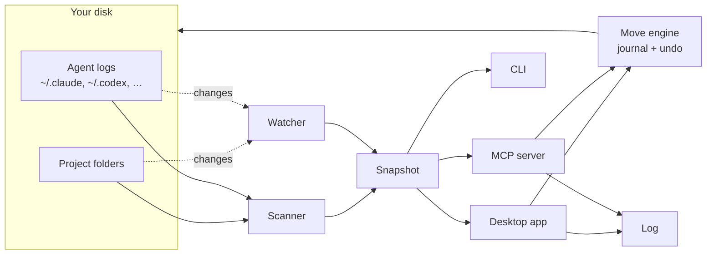

# laci

**A file manager for your projects folder that knows what's inside each project, including the AI agent history that belongs to it.**

*Laci* is Indonesian for "drawer".

laci shows every folder like a file manager, and for each project it adds its git state, README summary, stack, open to-dos, and the Claude Code, Codex or other agent sessions that worked in it. It warns you about work that exists only on this disk. When you move or archive a project, its agent history and memory move with it. Every change laci makes is logged and can be undone, and the app keeps itself up to date as you work.

<picture>
  <source media="(prefers-color-scheme: dark)" srcset="docs/screenshots/today-dark.png">
  
</picture>

> Status: v1.0, Linux only. Early software: expect rough edges. See the [changelog](CHANGELOG.md).

## Contents

- [Why](#why)
- [What it does](#what-it-does)
- [Getting started](#getting-started)
- [Using it](#using-it)
- [How it works](#how-it-works)
- [The `.laci.md` file](#the-lacimd-file)
- [Safety](#safety)
- [Configuration](#configuration)
- [Development](#development)
- [Roadmap](#roadmap)
- [FAQ](#faq)
- [License](#license)

## Why

If you work with coding agents, your projects folder gets messy in ways a regular file manager can't show:

- **Work only exists on your disk.** Repos with no remote, uncommitted changes, forgotten stashes. Nothing tells you until the disk dies.
- **Agent history is tied to a path.** Claude Code keeps sessions and memory under `~/.claude/projects/<encoded path>`. Codex writes the path into every log. Move or rename a folder and that history is detached. Ask an agent to "sort my projects" and it will `mv` things and leave the history behind.
- **Next steps are scattered.** They sit in `HANDOFF.md`, `TODO.md`, `NOTES.md` and chat history, and nobody reads them again.
- **Old history disappears.** Claude Code deletes session logs after 30 days by default.

laci puts all of this in one place and makes moving projects safe.

## What it does

### Today: what needs you

The home screen answers "what should I look at?". Each list says how it's ordered.

- **Could lose work**: no remote, never committed, uncommitted or unpushed changes, stashes. Each row has a one-click fix (for example *Create remote* or *Push*) that opens in the built-in terminal.
- **Pick up where you left off**: recently active projects, each with its last commit and last agent session.
- **Open to-dos**: every open `- [ ]` checkbox across your notes files, plus next steps you add in laci.
- **Handoffs**: `HANDOFF.md` or `TODO.md` files that still have open items under a TODO heading.

### Browse everything

Every folder and file, like Dolphin or Finder, with projects marked by their status, summary, stack, agent sessions and health. *Modified* means the same on every row: when anything inside last changed, whether a file, a commit or an agent session.

- **Filters**: *All files* shows the folder you're in. *Projects*, *Uses laci*, *Agent sessions* and *Needs attention* list matching projects in this folder and every folder below it.
- **Display**: sort by name, modified, size or agent sessions in either direction, keep folders first or mix them in, and show hidden files or archived projects. Column headers sort too.


### Projects and details

Select a project to see its summary, status, priority, deadline, remote, branch, stack and size. The panel has four tabs:

- **Health**: checks and a commit chart.
- **To-do**: next steps and notes.
- **Agents**: sessions, memory and plans from every connected tool.
- **README**: the rendered README.


### Tidy up

laci finds cleanups and shows exactly which files each one touches before anything changes. They're grouped by kind, fixes for broken links first:

- **Reconnect** agent history left at a folder's old address.
- **Finish half-done moves**: session folders that were renamed while the logs inside still record the old path.
- **Free space** from `node_modules` and build output in dormant or archived projects.
- **Duplicates**: the same repo cloned in two places.
- **Quarantine** sessions whose folder no longer exists.
- **Archive** projects nobody has touched in a while.


### Archive and move, with the history attached

Archiving moves a project into the nearest `_archive/` folder. laci also moves its agent history (Claude's session folder, and whatever else your connectors keep), rewrites the folder paths in the logs, and marks the project archived. Everything goes into an undo journal first.


### Log

Every change laci makes, from the app or from an agent through MCP: moves, archives, Tidy fixes, status, priority and deadline, to-dos, notes, connectors, settings and new projects. Moves expand to show what went where. Most changes have an *Undo*; one that was changed again later says so instead of overwriting the newer change.


### Agent history and connectors

A connector tells laci where an AI tool keeps its history, so it shows on the right project and travels with it. Claude Code, Codex, Gemini CLI, Claude plans, Serena and Aider are built in; laci suggests the ones it finds on your machine. Any other tool can be added with a short form, no code: its logs record the folder, it keeps one folder per project, it keeps history inside the project, or its files mention project paths.


### New project

<kbd>+</kbd> in the sidebar makes a project folder: empty, from a template in `~/.config/laci/templates`, or cloned from a URL. laci starts git with a first commit, writes a `.laci.md`, and can create a private repo on GitHub, GitLab or both (with `gh` and `glab`), set up so one `git push` updates both.

### Built-in terminal

Press <kbd>F4</kbd> for a terminal panel with real shells, one tab per project, each opened in the project's folder. *Resume session* runs `claude --resume <id>` there, and script buttons run `pnpm dev` and the like. Fix buttons type the command but wait for you to press Enter. Tabs survive a window reload.


### Stays current

laci watches your project folders, each project's files and git state, the agent logs and the folders you have open. New folders, edits, commits and agent sessions show up on their own, usually within a couple of seconds. The sidebar says *Up to date*; click it to scan everything again if something looks off.

### For agents: MCP

laci ships an [MCP](https://modelcontextprotocol.io) server, so Claude Code, Codex and other agents can ask laci what exists, and move, archive or create projects the safe way instead of using `ls` and `mv`. What they change shows up in the Log. See [Agents](#agents-mcp).

### In the terminal

`pnpm doctor` prints what could be lost, open checkboxes and tidy-up suggestions without opening the app.

## Getting started

### Requirements

- Linux (tested on Arch with Hyprland)
- git
- Node.js 23.6 or newer and pnpm, for installing and for the CLI
- A C/C++ toolchain (`make`, `g++`, `python3`), because `node-pty` builds locally
- Optional: `gh` and `glab`, to create repos from *New project*

### Install

```sh
git clone <this repo> ~/project/laci
cd ~/project/laci
pnpm install
pnpm start
```

The first launch asks three things: which folders hold your projects (laci suggests the ones with git repos), which AI tools you use, and which editor, file manager and terminal to open things with. You can change them later in Settings.

The first scan reads every agent log once, which can take 10 seconds or more if you have a lot of history. laci remembers what it read (in `~/.cache/laci`), so later scans take a few seconds, and the app opens with the last scan while it checks for changes. The desktop app runs on Electron's bundled Node, so it works even when your shell's Node comes from a version manager.

To add laci to your app launcher:

```sh
sh scripts/install-desktop.sh     # writes ~/.local/share/applications/laci.desktop
```

## Using it

### Desktop app

| Key | Action |
| --- | --- |
| <kbd>Ctrl</kbd> <kbd>K</kbd> | Jump to any project, folder or action |
| <kbd>F4</kbd> or <kbd>Ctrl</kbd> <kbd>`</kbd> | Show or hide the terminal |
| <kbd>Ctrl</kbd> <kbd>H</kbd> | Show or hide hidden files |
| <kbd>↑</kbd> <kbd>↓</kbd> <kbd>Enter</kbd> | Move through lists and open |
| <kbd>Backspace</kbd> | Go up one folder |
| <kbd>Esc</kbd> | Close the details panel, a menu or a dialog |

In the details panel, click **Status**, **Priority** or **Deadline** to change them. They are saved to the project's [`.laci.md`](#the-lacimd-file). **Editor** and the file manager button open the apps you picked in Settings. The theme switch (system, light, dark) is at the bottom of the sidebar.

Prefer a browser? `pnpm web` serves the same UI and opens it in Chromium's app mode, or in your default browser.

### CLI

```sh
pnpm ls        # every project, newest activity first
pnpm doctor    # could lose work, open checkboxes, tidy-up suggestions
pnpm proto     # a read-only HTML snapshot at prototype/dist/index.html
```

### Agents (MCP)

Register the server once. It runs on Electron's Node, like the app.

```sh
# Claude Code
claude mcp add laci --scope user -e ELECTRON_RUN_AS_NODE=1 -- \
  ~/project/laci/node_modules/electron/dist/electron ~/project/laci/src/mcp.ts
```

```toml
# Codex: ~/.codex/config.toml
[mcp_servers.laci]
command = "/home/you/project/laci/node_modules/electron/dist/electron"
args = ["/home/you/project/laci/src/mcp.ts"]
env = { ELECTRON_RUN_AS_NODE = "1" }
```

Then ask your agent things like *"which projects could lose work?"*, *"archive dummy2"*, *"move ~/Downloads/foo into ~/project/clients"* or *"start a new project called shop-api in ~/project/clients"*.

| Tool | What it does |
| --- | --- |
| `list_projects` | Projects with status, activity, summary, stack and problems. Filter by status or `at_risk` |
| `project_details` | Git, scripts, to-dos, notes, sessions, memory and archive destination of one project |
| `needs_attention` | Work at risk, open to-dos, deadlines, stale handoffs |
| `tidy_suggestions` | The Tidy up list |
| `set_project_fields` | Status, priority, deadline |
| `add_next_step`, `complete_task`, `write_notes` | Edit to-dos and notes |
| `move_project`, `archive_project`, `apply_suggestion`, `create_project` | Changes on disk. Two calls: the first returns the plan, the second (with `confirm: true`) runs it |
| `recent_changes`, `undo_change` | The Log, and undo |

Moves and new projects must stay inside your home folder, and only one laci process (the app or an agent) changes files at a time.

## How it works



- **Finding projects.** laci walks the folders you picked (Settings). A folder is a *project* if it has `.git` or a build file (`package.json`, `go.mod`, `Cargo.toml`, `pyproject.toml`, `composer.json`, `pubspec.yaml` and more). A folder that only holds notes, or one an agent worked in, is a *docs project*. A folder of projects is a *group*. These are fixed rules, not guesses by an AI.
- **Reading each project.** It reads the git state (commits, remote, branch, uncommitted, unpushed, stashes and weekly activity), the README (title, summary, links), the stack from package files, and to-dos from `.laci.md`, `HANDOFF*.md`, `TODO*.md`, `NOTES*.md` and `tasks/todo.md`.
- **Linking agent history.** Each connector says how its tool links history to a folder. Claude Code names its session folders after the path with every non-alphanumeric character turned into `-`, so the name can't be decoded back; laci walks the real filesystem to find the folder a name belongs to. Codex logs are linked by the `cwd` inside them, Gemini CLI by a hash of the path, and Claude plans by the paths they mention. What laci learns from each log is cached, and a growing log is read from where the last read stopped.
- **Staying current.** After a scan, laci watches the folders where projects live, the files and git state of each project, the agent log folders and the folders open in the app. It then re-reads only what changed: one project, the agent logs, or (when folders appear or disappear) a full scan.
- **Status.** Status is set automatically from the last activity (commit, file change or agent session): *active* within 14 days, *idle* within 60, *dormant* after that, and *archived* inside an `_archive` folder. Set it by hand to override. Editing `.laci.md` doesn't count as activity.
- **Former locations.** When a session folder resolves to a real folder but its sessions *started* somewhere that no longer exists, that old path is a former location. This is how laci spots half-done moves and renames, such as a repo renamed from `shop-old` to `shop`.

## The `.laci.md` file

The things you set yourself (status, priority, deadline, next steps and notes) live in a small file inside the project, so they move with it and any editor or agent can read them:

```markdown
---
status: active
priority: high
deadline: 2026-10-15
---

## Summary
One or two sentences about the project. Shown instead of the README tagline.

## Next
- [ ] Fix checkout total on mobile Safari

## Notes
Client wants the launch before the coffee expo.
```

laci adds `.laci.md` to the repo's `.git/info/exclude` (not `.gitignore`), so it is never committed and your repo files stay unchanged.

## Safety

| When | What happens |
| --- | --- |
| Scanning and watching | Read-only. `git status` runs with `GIT_OPTIONAL_LOCKS=0`, so it never touches the index |
| Status, priority, deadline, to-dos, notes | Written to `.laci.md` in the project |
| Ticking a checkbox | Changes that line in the file it came from, for example `NOTES.md` |
| Archive, move, reconnect, finish a move | Moves folders, renames agent history folders, rewrites the folder path in agent logs (keeping each log's time) |
| Free space | Sends `node_modules`, `.next` and similar folders to the system trash |
| Back up logs | Copies agent logs to `~/.local/share/laci/history` |
| New project | Makes the folder; creates a remote repo only if you pick one |

- **Undo.** Every move and rewrite is written to `~/.local/share/laci/journal/` *before* it happens. Rewritten files are kept in `~/.local/share/laci/backup/`. Undo restores them byte for byte. If a step fails midway, laci rolls back what it already did.
- **Log.** Every change is also listed in `~/.local/share/laci/activity.jsonl`, which the Log page reads. Undo from the Log goes through the same checks as the app, and never reaches outside your home folder.
- **Busy folders are refused.** If a running process (a `claude` session, a dev server) has a folder open, laci won't move it.
- **One change at a time.** A lock file keeps the app and agents from changing files at once.
- **Local only.** The UI talks to a server on `127.0.0.1` that requires a per-launch token and rejects other host names, so websites can't reach it. The only network request is the Geist font from Google Fonts. There is no telemetry.

## Configuration

Settings are saved in `~/.config/laci/config.json` (or under `$XDG_CONFIG_HOME`). Paths are stored as `~/…`.

| Key | |
| --- | --- |
| `roots` | Folders laci looks for projects in |
| `presets` | Built-in connectors you added |
| `custom` | Connectors you described yourself |
| `apps` | `terminal`, `editor` and `files`: the programs laci opens things with |
| `theme` | `light` or `dark`; missing means follow the system |

Environment variables win over the file, for one-off runs:

| Variable | Default | |
| --- | --- | --- |
| `LACI_PORT` | `4747` | Port of the local server |
| `LACI_TERMINAL` | from Settings, else `kitty` | External terminal |
| `LACI_EDITOR` | from Settings, else `code` | Editor opened by **Editor** |
| `LACI_FILES` | from Settings, else `dolphin` | File manager |
| `LACI_DEBUG` | off | Also log file watcher events to the debug log |

Other files laci keeps:

| Path | |
| --- | --- |
| `~/.config/laci/templates/` | Starting points for *New project*: each folder is one template |
| `~/.local/share/laci/` | Undo journals, backups, the Log (`activity.jsonl`) and the debug log (`laci.log`) |
| `~/.cache/laci/` | What laci learned from agent logs, and the last scan. Safe to delete |

## Development

```
src/core/        scanner, parsers, health checks, tidy-up suggestions, move engine, log
  agents/        connectors: Claude Code and the generic readers, plus their cache
src/server.ts    local API for the UI
src/watch.ts     file watching for live updates
src/term.ts      terminal sessions (node-pty), streamed to the UI
src/mcp.ts       MCP server
src/cli.ts       CLI
electron/        desktop window; starts the server with Electron's Node
prototype/       the UI, one HTML file
scripts/         launcher install, sandbox and demo data
test/            tests
```

The code is TypeScript that runs directly on Node 23.6+ (type stripping), with no build step. Stack: Electron 44, node-pty, xterm.js and the MCP TypeScript SDK v2.

```sh
pnpm test        # move engine, undo, API security and MCP tests, against a throwaway HOME
pnpm typecheck
```

To try changes without touching your real projects, run laci against a fake home:

```sh
node scripts/demo.ts /tmp/laci-demo          # clients, a thesis, side projects, agent history
HOME=/tmp/laci-demo XDG_CONFIG_HOME= XDG_CACHE_HOME= LACI_PORT=4848 node src/server.ts --open
```

The screenshots in this README come from that demo data.

## Roadmap

- Manage agent sessions from laci
- File operations in the browser: copy, rename, delete, preview
- Packages: AppImage and `.deb`
- Search across agent sessions ("when did I talk about Midtrans?")
- Summaries written by an agent for projects without a README
- Windows

## FAQ

**Does it show every folder, like Dolphin?**
Yes. Browse from your project folders or from Home. Projects get their status and details on top of the usual file list.

**Will it change my repos?**
Only if you ask it to. Scanning is read-only, `.laci.md` is excluded from git, and moves go through the undo journal.

**Why does the first scan take a while?**
laci reads every agent log once to see which folder each belongs to. After that it only reads logs that changed, so later scans take a few seconds.

**Do I need to press "Scan again"?**
Normally no. laci watches for changes and updates by itself. A full scan is there in case something looks off.

**Does it send my code anywhere?**
No. Everything stays on your machine.

## License

Not chosen yet.
