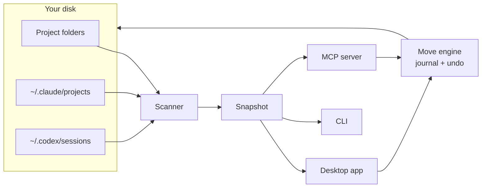

# laci

**A file manager for your projects folder that knows what's inside each project, including the AI agent history that belongs to it.**

*Laci* is Indonesian for "drawer".

laci scans your project folders and shows, for each one: git state, README summary, stack, open to-dos, and the Claude Code and Codex sessions that worked in it. It warns you about work that exists only on this disk. When you move or archive a project, its agent history and memory move with it, and every change can be undone.

<picture>
  <source media="(prefers-color-scheme: dark)" srcset="docs/screenshots/today-dark.png">
  
</picture>

> Status: early (v0.1), Linux only. Expect rough edges.

## Contents

- [Why](#why)
- [What it does](#what-it-does)
- [Getting started](#getting-started)
- [Using it](#using-it)
- [How it works](#how-it-works)
- [The `.laci.md` file](#the-lacimd-file)
- [Safety](#safety)
- [Configuration](#configuration)
- [Development](#development)
- [Roadmap](#roadmap)
- [FAQ](#faq)
- [License](#license)

## Why

If you work with coding agents, your projects folder gets messy in ways a regular file manager can't show:

- **Work only exists on your disk.** Repos with no remote, uncommitted changes, forgotten stashes. Nothing tells you until the disk dies.
- **Agent history is tied to a path.** Claude Code keeps sessions and memory under `~/.claude/projects/<encoded path>`. Codex writes the path into every log. Move or rename a folder and that history is detached. Ask an agent to "sort my projects" and it will `mv` things and leave the history behind.
- **Next steps are scattered.** They sit in `HANDOFF.md`, `TODO.md`, `NOTES.md` and chat history, and nobody reads them again.
- **Old history disappears.** Claude Code deletes session logs after 30 days by default.

laci puts all of this in one place and makes moving projects safe.

## What it does

### Today: what needs you

The home screen answers "what should I look at?":

- **Could lose work**: no remote, never committed, uncommitted or unpushed changes, stashes. Each row has a one-click fix (for example *Create remote* or *Push*) that opens in the built-in terminal.
- **Pick up where you left off**: recently active projects, each with its last commit and last agent session.
- **Open to-dos**: every open `- [ ]` checkbox across your notes files, plus next steps you add in laci.
- **Handoffs**: `HANDOFF.md` or `TODO.md` files that still have open items under a TODO heading.

### Projects and details

Browse your project folders. Select one to see its summary, status, priority, deadline, remote, branch, stack and size. The panel has four tabs:

- **Health**: checks and a commit chart.
- **To-do**: next steps and notes.
- **Agents**: sessions, memory and plans.
- **README**: the rendered README.


### Tidy up

laci finds cleanups and shows exactly which files each one touches before anything changes:

- **Reconnect** agent history left at a folder's old address.
- **Finish half-done moves**: session folders that were renamed while the logs inside still record the old path.
- **Quarantine** sessions whose folder no longer exists.
- **Free space** from `node_modules` and build output in dormant or archived projects.
- **Archive** projects nobody has touched in a while.
- **Duplicates**: the same repo cloned in two places.


### Archive and move, with the history attached

Archiving moves a project into the nearest `_archive/` folder. laci also moves its Claude session folder, rewrites the `cwd` paths in the Claude and Codex logs, and marks the project archived. Everything goes into an undo journal first.


### Built-in terminal

Press <kbd>F4</kbd> for a terminal panel with real shells, one tab per project, each opened in the project's folder. *Resume session* runs `claude --resume <id>` there, and script buttons run `pnpm dev` and the like. Fix buttons type the command but wait for you to press Enter. Tabs survive a window reload.


### For agents: MCP

laci ships an [MCP](https://modelcontextprotocol.io) server, so Claude Code, Codex and other agents can ask laci what exists and move projects the safe way instead of using `ls` and `mv`. See [Agents](#agents-mcp).

### In the terminal

`pnpm doctor` prints what could be lost, open checkboxes and tidy-up suggestions without opening the app.

## Getting started

### Requirements

- Linux (tested on Arch with Hyprland)
- git
- Node.js 23.6 or newer and pnpm, for installing and for the CLI
- A C/C++ toolchain (`make`, `g++`, `python3`), because `node-pty` builds locally

### Install

```sh
git clone <this repo> ~/project/laci
cd ~/project/laci
pnpm install
pnpm start
```

The first scan takes about 10 seconds, because laci reads every agent log to link it to a folder. The desktop app runs on Electron's bundled Node, so it works even when your shell's Node comes from a version manager.

To add laci to your app launcher:

```sh
sh scripts/install-desktop.sh     # writes ~/.local/share/applications/laci.desktop
```

## Using it

### Desktop app

| Key | Action |
| --- | --- |
| <kbd>Ctrl</kbd> <kbd>K</kbd> | Jump to any project, folder or action |
| <kbd>F4</kbd> or <kbd>Ctrl</kbd> <kbd>`</kbd> | Show or hide the terminal |
| <kbd>↑</kbd> <kbd>↓</kbd> <kbd>Enter</kbd> | Move through lists and open |
| <kbd>Backspace</kbd> | Go up one folder |
| <kbd>Esc</kbd> | Close the details panel or a dialog |

In the details panel, click **Status**, **Priority** or **Deadline** to change them. They are saved to the project's [`.laci.md`](#the-lacimd-file). **Editor** opens VS Code and **Dolphin** opens the file manager.

Prefer a browser? `pnpm web` serves the same UI and opens it in Chromium's app mode, or in your default browser.

### CLI

```sh
pnpm ls        # every project, newest activity first
pnpm doctor    # could lose work, open checkboxes, tidy-up suggestions
pnpm proto     # a read-only HTML snapshot at prototype/dist/index.html
```

### Agents (MCP)

Register the server once. It runs on Electron's Node, like the app.

```sh
# Claude Code
claude mcp add laci --scope user -e ELECTRON_RUN_AS_NODE=1 -- \
  ~/project/laci/node_modules/electron/dist/electron ~/project/laci/src/mcp.ts
```

```toml
# Codex: ~/.codex/config.toml
[mcp_servers.laci]
command = "/home/you/project/laci/node_modules/electron/dist/electron"
args = ["/home/you/project/laci/src/mcp.ts"]
env = { ELECTRON_RUN_AS_NODE = "1" }
```

Then ask your agent things like *"which projects could lose work?"*, *"archive dummy2"* or *"move ~/Downloads/foo into ~/project/clients"*.

| Tool | What it does |
| --- | --- |
| `list_projects` | Projects with status, activity, summary, stack and problems. Filter by status or `at_risk` |
| `project_details` | Git, scripts, to-dos, notes, sessions, memory and archive destination of one project |
| `needs_attention` | Work at risk, open to-dos, deadlines, stale handoffs |
| `tidy_suggestions` | The Tidy up list |
| `set_project_fields` | Status, priority, deadline |
| `add_next_step`, `complete_task`, `write_notes` | Edit to-dos and notes |
| `move_project`, `archive_project`, `apply_suggestion` | Changes on disk. Two calls: the first returns the plan, the second (with `confirm: true`) runs it |
| `recent_changes`, `undo_change` | The journal, and undo |

Moves must stay inside your home folder, and only one laci process (the app or an agent) changes files at a time.

## How it works



- **Finding projects.** laci walks `~/project`, `~/tugas`, `~/Documents`, `~/Desktop` and `~/Downloads` (plus `~/code`, `~/dev`, `~/src`, `~/repos` and `~/work` if they exist). A folder is a *project* if it has `.git` or a build file (`package.json`, `go.mod`, `Cargo.toml`, `pyproject.toml`, `composer.json`, `pubspec.yaml` and more). A folder that only holds notes is a *docs project*. A folder of projects is a *group*.
- **Reading each project.** It reads the git state (commits, remote, branch, uncommitted, unpushed, stashes and weekly activity), the README (title, summary, links), the stack from package files, and to-dos from `.laci.md`, `HANDOFF*.md`, `TODO*.md`, `NOTES*.md` and `tasks/todo.md`.
- **Linking agent history.** Claude Code names its session folders after the path with every non-alphanumeric character turned into `-`, so the name can't be decoded back. laci walks the real filesystem to find the folder a name belongs to. Codex logs are linked by the `cwd` inside them, and Claude plans by the paths they mention.
- **Status.** Status is set automatically from the last activity (commit, file change or agent session): *active* within 14 days, *idle* within 60, *dormant* after that, and *archived* inside an `_archive` folder. Set it by hand to override.
- **Former locations.** When a session folder resolves to a real folder but its sessions *started* somewhere that no longer exists, that old path is a former location. This is how laci spots half-done moves and renames, such as a repo renamed from `shop-old` to `shop`.

## The `.laci.md` file

The things you set yourself (status, priority, deadline, next steps and notes) live in a small file inside the project, so they move with it and any editor or agent can read them:

```markdown
---
status: active
priority: high
deadline: 2026-10-15
---

## Summary
One or two sentences about the project. Shown instead of the README tagline.

## Next
- [ ] Fix checkout total on mobile Safari

## Notes
Client wants the launch before the coffee expo.
```

laci adds `.laci.md` to the repo's `.git/info/exclude` (not `.gitignore`), so it is never committed and your repo files stay unchanged.

## Safety

| When | What happens |
| --- | --- |
| Scanning | Read-only. `git status` runs with `GIT_OPTIONAL_LOCKS=0`, so it never touches the index |
| Status, priority, deadline, to-dos, notes | Written to `.laci.md` in the project |
| Ticking a checkbox | Changes that line in the file it came from, for example `NOTES.md` |
| Archive, move, reconnect, finish a move | Moves folders, renames `~/.claude/projects/<dir>`, rewrites `"cwd"` fields in Claude and Codex logs |
| Free space | Sends `node_modules`, `.next` and similar folders to the system trash |
| Back up logs | Copies agent logs to `~/.local/share/laci/history` |

- **Undo.** Every move and rewrite is written to `~/.local/share/laci/journal/` *before* it happens. Rewritten files are kept in `~/.local/share/laci/backup/`. Undo restores them byte for byte. If a step fails midway, laci rolls back what it already did.
- **Busy folders are refused.** If a running process (a `claude` session, a dev server) has a folder open, laci won't move it.
- **One change at a time.** A lock file keeps the app and agents from changing files at once.
- **Local only.** The UI talks to a server on `127.0.0.1` that requires a per-launch token and rejects other host names, so websites can't reach it. The only network request is the Geist font from Google Fonts. There is no telemetry.

## Configuration

| Variable | Default | |
| --- | --- | --- |
| `LACI_PORT` | `4747` | Port of the local server |
| `LACI_TERMINAL` | `kitty` | External terminal (`konsole` also works) |
| `LACI_EDITOR` | `code` | Editor opened by **Editor** |
| `LACI_FILES` | `dolphin` | File manager opened by **Dolphin** |

The folders laci scans are fixed for now (see [How it works](#how-it-works)).

## Development

```
src/core/        scanner, parsers, health checks, tidy-up suggestions, move engine
  agents/        Claude Code, Codex and plan readers
src/server.ts    local API for the UI
src/term.ts      terminal sessions (node-pty), streamed to the UI
src/mcp.ts       MCP server
src/cli.ts       CLI
electron/        desktop window; starts the server with Electron's Node
prototype/       the UI, one HTML file
scripts/         launcher install, sandbox and demo data
test/            tests
```

The code is TypeScript that runs directly on Node 23.6+ (type stripping), with no build step. Stack: Electron 44, node-pty, xterm.js and the MCP TypeScript SDK v2.

```sh
pnpm test        # move engine, API security and MCP tests, against a throwaway HOME
pnpm typecheck
```

To try changes without touching your real projects, run laci against a fake home:

```sh
node scripts/demo.ts /tmp/laci-demo          # clients, a thesis, side projects, agent history
HOME=/tmp/laci-demo LACI_PORT=4848 node src/server.ts --open
```

The screenshots in this README come from that demo data.

## Roadmap

- **Browse any folder**, not only projects: the plain file manager part (copy, rename, preview files)
- Live updates by watching the disk, instead of rescanning
- Packages: AppImage and `.deb`
- More agents: Gemini CLI, Cursor, Aider
- Search across agent sessions ("when did I talk about Midtrans?")
- Summaries written by an agent for projects without a README
- Windows

## FAQ

**Does it show every folder, like Dolphin?**
Not yet. It shows project folders and the folders that contain them. General file browsing is on the roadmap.

**Will it change my repos?**
Only if you ask it to. Scanning is read-only, `.laci.md` is excluded from git, and moves go through the undo journal.

**Why does the first scan take 10 seconds?**
laci reads every Claude and Codex log to see which folder each belongs to. Most of the time is spent on large session files.

**Does it send my code anywhere?**
No. Everything stays on your machine.

## License

Not chosen yet.
